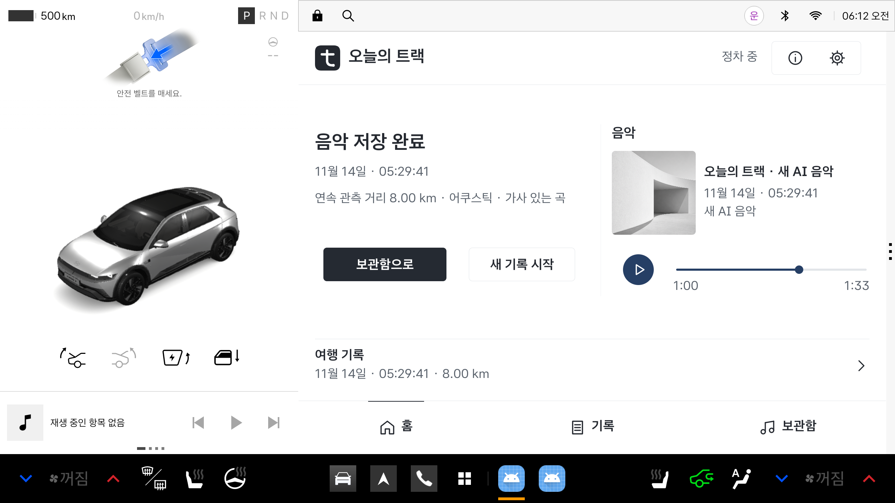
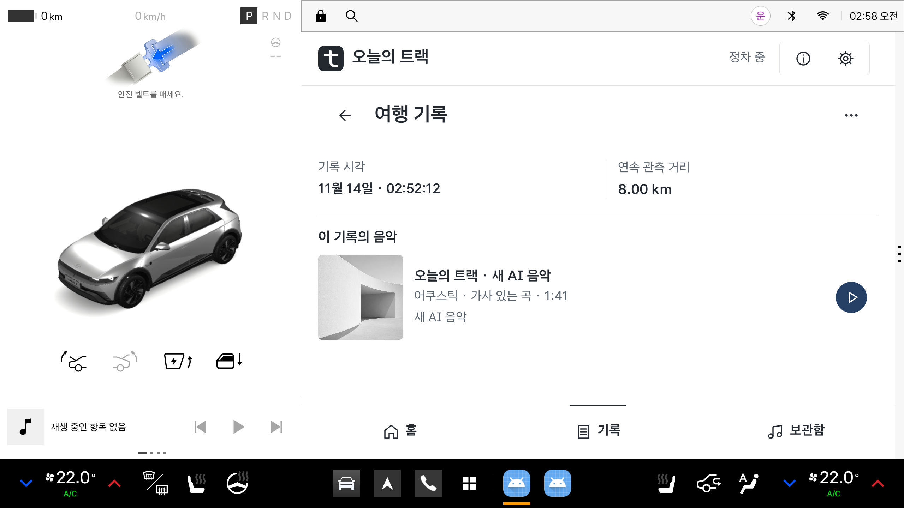
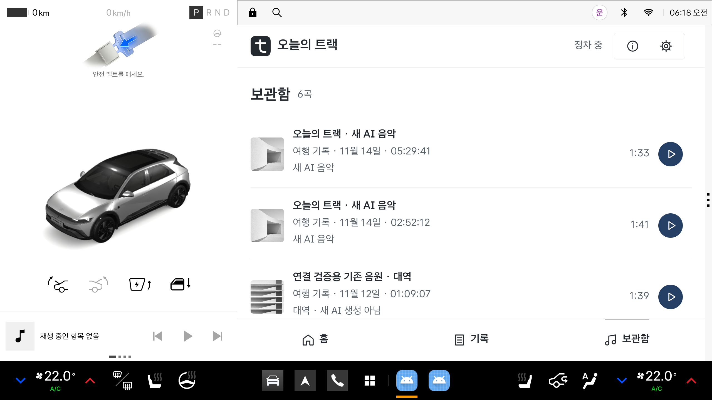
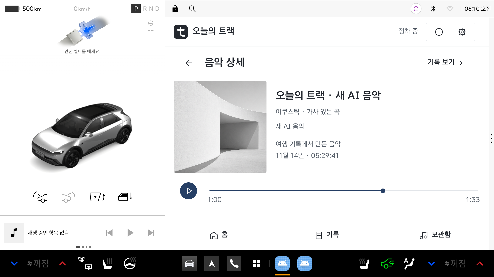
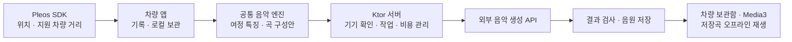

<div align="center">


# 오늘의 트랙 · Today's Track

### 달린 길이 음악이 되다.

**맘보코어 · MamboCore**

주행이 끝난 뒤, 차량에 기록된 여정으로 AI 음악을 만들어 함께 달린 시간을 한 곡으로 간직하는 **Pleos Connect 앱**입니다.


**[시연 영상 ↗](https://youtu.be/bQ5uMmf7UIw)** · **[APK 다운로드](https://github.com/xiuiworld/TodaysTrack/releases/download/submission-v0.4.0/MamboCore_TodaysTrack_release.apk)** · **[설치·실행 안내](docs/submission/runbook.md)** · **[기획서](docs/proposal.md)**

</div>

## 실제 Pleos 화면



<table>
  <tr><th>기록과 연결된 음악</th><th>보관함</th><th>음악 상세</th></tr>
  <tr>
    <td><a href="docs/assets/pleos-record.png"></a></td>
    <td><a href="docs/assets/pleos-library.png"></a></td>
    <td><a href="docs/assets/pleos-song.png"></a></td>
  </tr>
</table>

Android 앱의 실제 캡처입니다. 날짜·거리·곡은 **에뮬레이터의 SDK 합성 주행 검증 데이터**이며 실도로 주행 결과가 아닙니다. 고정 커버는 장식 이미지입니다. [캡처 출처와 버전](docs/assets/README.md)

## 한 번의 여정을 한 곡으로

**기록 시작 → 기록 마감 → 음악 만들기 → 차량에 저장 → 보관함에서 다시 듣기**

| 단계 | 앱에서 하는 일 |
| --- | --- |
| 기록 | 출발 전 기록을 시작하고, Pleos SDK의 위치와 지원 차량 누적거리 정보를 수집합니다. |
| 마감 | 관측된 거리와 기록을 확인합니다. 주행 중 추가 입력을 요구하지 않습니다. |
| 음악 만들기 | 정차 후 설정·요약 전송 안내를 확인하고, 여정 특징과 곡 구성안으로 AI 음악을 요청합니다. |
| 감상 | 완성곡을 차량에 저장하고, 보관함에서 원래 기록과 함께 찾고 재생합니다. 저장곡은 오프라인에서도 다시 듣습니다. |

정밀 좌표는 차량 로컬에 보관하고 생성에 필요한 요약을 서버에 전달합니다. 차량 화면 제한(CarUx), 대역 음원 표시, 생성 전 전송 안내를 적용합니다.

## 구현 범위와 확인 결과

| 구분 | 현재 상태 |
| --- | --- |
| 차량 앱 | Kotlin · Android Views. 홈, 기록 목록·상세, 보관함·음악 상세, 설정과 재생 제어를 구현했습니다. |
| 핵심 흐름 | 동일 UI·엔진 코드에서 SDK 합성 8km 기록 → 실제 AI 음악 2곡 생성 → 차량 저장·재생을 확인했습니다. |
| 최종 0.4 앱 | 동일 서명 업데이트, 기존 기록·곡 보존, 새 기록 시작·마감·생성 승인 대기, 저장곡의 콜드 시작 후 첫 클릭 오프라인 재생을 확인했습니다. |
| 검사 | 제출 코드 기준 차량 48 · 서버 44 · 공통 엔진 18개 검사 통과. 검증 당시의 결과이며 상시 CI 배지가 아닙니다. |
| 후속 계획 | 폰 연계·일반 로그인·앨범·동기화·공유, 실차·장시간 검증, 운영 배포는 후속 범위입니다. |

**확인 범위:** 영상은 버전 고정 전 0.3(4)의 동일 UI·엔진 코드로 촬영했습니다. 생성 대기를 단축했으며 마지막 재감상은 별도 촬영입니다. 최종 0.4에서 새 유료 곡을 다시 생성하지 않았고, 청취 품질·실차 동작은 검증 완료로 표시하지 않습니다. [검증 결과와 한계](docs/submission/verification.md)

## 다운로드와 실행

| 자료 | 경로 |
| --- | --- |
| 제출 Release | [0.4.0-submission(5)](https://github.com/xiuiworld/TodaysTrack/releases/tag/submission-v0.4.0) |
| 저장소 APK | [apk/MamboCore_TodaysTrack_release.apk](apk/MamboCore_TodaysTrack_release.apk) |
| Release APK | [MamboCore_TodaysTrack_release.apk](https://github.com/xiuiworld/TodaysTrack/releases/download/submission-v0.4.0/MamboCore_TodaysTrack_release.apk) |
| 검증된 소스 ZIP | [TodaysTrack-source.zip](https://github.com/xiuiworld/TodaysTrack/releases/download/submission-v0.4.0/TodaysTrack-source.zip) |
| 파일 해시 | [SHA256SUMS.txt](https://github.com/xiuiworld/TodaysTrack/releases/download/submission-v0.4.0/SHA256SUMS.txt) |
| 시연 영상 | [YouTube · 오늘의 트랙 시연](https://youtu.be/bQ5uMmf7UIw) |

APK·소스 ZIP의 실행 코드 기준은 [d7d99c4](https://github.com/xiuiworld/TodaysTrack/tree/d7d99c4ed6ef6a8d8c24c605475ee6b3723e38aa), 고정 태그는 `submission-v0.4.0`입니다. **main에는 이후 기획서·심사용 문서 정리가 포함됩니다.** 자동 생성되는 GitHub 소스 압축과 별도로, 재빌드 검증한 소스 ZIP을 첨부합니다.

**검증 환경**은 Windows · PowerShell 7 · JDK 17 · Android SDK 35 · Pleos Connect 2.1.0(API 34)입니다. 화면 규격은 **2560×1440 / 160dpi**, 실제 앱 영역은 **1682×1210**입니다. 설치·소스 빌드·기기 연결 절차는 [실행 안내](docs/submission/runbook.md)를 따릅니다.

> 새 설치에는 기존 사용자의 기록·곡이 포함되지 않습니다. 새 음악 생성에는 PC 서버·인터넷·별도 비용 승인이 필요합니다. 기본 설정은 유료 API를 호출하지 않으며, 이미 저장한 곡은 서버 없이 재생할 수 있습니다.

## 구성



```text
TodaysTrack/
├── vehicle/       Android 차량 앱 · Room · Media3
├── music-core/    차량·서버가 공유하는 여정 특징·음악 구성 로직
├── server/        Ktor 서버 · 작업 원장 · 음악 제공자 연동
├── docs/          기획 · 설계 · 검증 · 제출 안내
├── tools/         빌드·패키징 도구와 브라우저 UI 비교 도구
└── validation/    SDK·통합 흐름을 확인하는 검증 스크립트
```

브라우저 UI 비교 도구는 모의 데이터를 사용하는 개발 도구이며 Android 앱이나 실제 생성·재생 검증을 대신하지 않습니다. 키·DB·사용자 데이터·원본 기기 증거·빌드 캐시는 Git에 포함하지 않습니다.

## 더 살펴보기

[문서 목차](docs/README.md) · [앱 기획서](docs/proposal.md) · [설치·실행](docs/submission/runbook.md) · [검증·한계](docs/submission/verification.md) · [설계 v0.2](docs/design/README.md) · [후속 계획](docs/development/implementation-follow-up.md)

이 저장소는 심사·검토를 위해 공개합니다. 직접 작성한 코드에 별도 오픈소스 라이선스를 부여하지 않습니다. 제3자 구성 요소는 각 라이선스를 따릅니다. [제3자 고지와 자산 출처](THIRD_PARTY_NOTICES.md)
