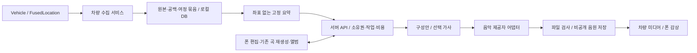

# 오늘의 트랙 · 시스템 설계

작성·리뷰: 2026-11-12 KST · 설계 v0.2 · 상태: 내부 기획/최신 검증 대조 리뷰 반영, 제품 구현 착수 전

**차량에서 기록을 보존하고 전체 여정을 정리한 뒤, 서버의 AI 생성 작업으로 곡을 만들고 차량과 폰에서 소장한다.** 첫 생성은 차량에서 시작한다. 서버가 실제 AI 호출을 수행하는 것은 이 제품 정책과 양립한다.

이 문서는 [내부 기획서](../product/product-plan.md)의 제품 방향과 이번 사용자 결정을 기술 구조로 구체화한다. 기술 상태는 [기술 검증 기록의 마지막 통합 결과](../development/technical-validation.md#e1e4-통합-검증-결과)를 우선한다. 기획서·AGENTS.md의 ‘SDK·음원 미검증’ 및 ‘설계 이전’ 문구는 과거 상태이며, 제품 전체가 구현됐다는 뜻으로 반대로 해석하지도 않는다. [이전 검토 메모](deferred-design-notes.md)와 [과거 심사 검토](../reviews/2026-11-12-proposal-review.md)는 이력이다. 규칙 기반 악보 엔진·고정 마디·동일 음원 재현을 계승하지 않는다.

## 1. 읽는 순서와 상태 표기

| 문서 | 다루는 계약 |
| --- | --- |
| 이 문서 | 책임·사용자 흐름·생성 파이프라인·폰·개인정보·결정·개발 순서 |
| [기록과 여정](recording-and-journeys.md) | SDK 수명주기·백그라운드·시간과 거리·저장·복구·하루/여행 묶음 |
| [데이터와 작업 계약](data-api-and-jobs.md) | 모델·상태·API·동기화·재생성·비용·삭제 경합 |

**확정**은 사용자가 정한 요구, **결정**은 이번 설계의 권고 기준, **가정**은 아직 환경에서 확인하지 않은 전제, **미결**은 후속 선택이 필요한 사항, **검증 필요**는 실행 증거가 필요한 사항이다. ‘결정’은 사용자 최종 승인이나 동작 확인을 뜻하지 않는다. 미결 항목은 영향받는 단계에만 붙이며 전체 설계를 보류하지 않는다.

**이번 작업의 경계:** 설계 문서만 작성한다. 제품 코드·배포·추가 유료 API·충전·키 조회/출력·상주 작업자·훅·개인 메모리 저장을 실행하지 않는다. Windroid 중단을 유지한다. 제출용 기획서와 7번 참고자료를 변경하지 않는다. 기존 `validation/`의 Activity/Python probe는 증거·입력 fixture이며 완성 서비스로 승격하지 않는다. 검토는 한 명의 자체 검토다.

## 2. 설계 출발점

| 구분 | 현재 근거와 한계 | 설계에 미치는 영향 |
| --- | --- | --- |
| 확인 | Pleos Connect 2.1.0, Vehicle 2.3.2, FusedLocation 1.1.3에서 누적거리·위치 갱신 | capability와 실제 오류를 함께 다루는 SDK 어댑터 |
| 확인 | 구간 시간·거리 API는 `NOT_SUPPORTED_PROPERTY` | 필수 입력 제외. 앱 단조 시각·유효 누적거리 차이 사용 |
| 확인 | 합성 A→B→C→C→B→A, 6개 검사 지점 일치, 누적거리 차이 6km | 실제 SDK 수신을 확인한 합성 여정이며 도로 주행 검증은 아님 |
| 확인 | 관측 범위 53.414초, 중단 공백 18.323초, 파일 이어 읽기 | 관측 범위·수집 가능 시간·미관측 시간을 분리 |
| 확인 | 원본→요약→요청→MP3 해시 연결, 응답 27.617초·음원 99.71초·전체 디코딩 | AI 곡 연결의 근거. 서비스 지연 보장·품질 판정으로 전용하지 않음 |
| 미검증 | 실제 백그라운드, 장시간·전원 복구·자동 경계·폰 동기화 | 초기 수집 구조 검증과 후속 통합 검증으로 배치 |
| 미검증 | AI 가사 자동 작성·실제 가창·여정 구조 준수·청취 가치 | 텍스트/오디오/청취 평가를 구분 |

원본 근거: [SDK 수집 세션](../../validation/journey-probe/runs/sdk-journey-20261112-071730/), [음악 통합 결과](../../validation/music-probe/results/sdk-journey/). 음악 생성 승인은 모두 소진됐다. 이번 설계에 실행 허용량을 새로 부여하지 않는다.

검증 환경은 JDK17·Android SDK35·위 SDK/이미지 조합과 이 PC의 software GPU 모드다. 설치한 SDK35와 에뮬레이터 OS/제품 targetSdk·minSdk는 서로 다른 값이다. 이 결과를 하드웨어 GPU나 실제 차량의 성능·백그라운드 동작으로 일반화하지 않는다.

## 3. 책임과 배치

| 주체 | 책임 | 경계 |
| --- | --- | --- |
| 차량 | SDK·원본 저장·수집 공백·구간/묶음·좌표 제거 요약·첫 생성 요청·미디어 | 네트워크 없이 기록 가능. 음악 제공자 비밀키 없음 |
| 서버 | 계정/기기 연결·소유권·고정 입력·구성안/가사·AI 호출·예산·음원·동기화·삭제 | 좌표 원본 수집을 기본 API에 넣지 않음. 제공자 비밀키를 유일하게 보유 |
| 폰 | 기존 곡 감상·보관·다운로드·공유·제목/커버·사진/메모·재생성·앨범·설정 | SDK 수집 없음. 새 기록 첫 생성은 불가. 첫 생성 전 선택 입력 추가는 가능 |
| 외부 AI | 요청된 실제 음악과 선택 보컬 생성 | 사실 판정자·영구 보관소·여정 DB가 아님 |

**결정 D1 — 차량 로컬 + 작은 서버를 권고한다.** 차량만으로 외부 AI를 직접 호출하면 키·비용·폰 전달을 보호하기 어렵다. 모든 원본을 서버에 올리는 대안은 중앙 재처리가 쉽지만 정밀 경로 노출과 오프라인 기록 의존을 키운다. 요약을 외부 전송하는 절충안이 현재 경험에 맞는다. 앱만으로 음악을 만드는 로컬 모델은 Pleos 자원·음질 증거가 없어 기준으로 삼지 않는다.

**결정 D2 — 차량은 Kotlin/Android, 로컬 Room, 서비스 소유의 구조화 coroutine 범위, 재생은 Media3 후보.** 화면→도메인→저장소 계약으로 분리하고 SDK·DB·HTTP 구현은 도메인 밖에 둔다. 처음부터 많은 Gradle 모듈을 만들지 않고 차량 앱 내부 패키지 경계로 시작한다. SDK 연결은 수집 서비스가 소유하고, 수집·화면·재생은 독립된 수명주기를 갖는다. Room을 권고하는 이유는 이벤트/체크포인트/발신 대기의 원자적 저장과 마이그레이션이다. JSONL은 진단 내보내기용으로 남긴다. iOS 공유 코드가 필요해질 때 KMP/SQLDelight를 재검토한다.

**결정 D3 — 서버는 Kotlin/Ktor 단일 서비스, PostgreSQL, 비공개 S3 호환 객체 저장을 권고한다.** 한 저장소의 API/생성 worker 역할로 나누되 PostgreSQL 작업 lease·outbox로 시작해 별도 Redis/Kafka·마이크로서비스를 선행하지 않는다. 별도 worker 배포는 실행시간/부하 측정 후 분리한다. TypeScript/FastAPI도 가능하지만 차량과 모델·도메인 언어를 맞추는 편을 권고한다. 호스팅 사업자·인증 공급자는 미결이며 클라우드 종속 ID를 도메인 ID로 쓰지 않는다. 이것은 설치·배포 지시가 아니다.

**가정 A1:** 차량에서 서버로 통신하고 앱 전용 저장소를 사용할 수 있다. **가정 A2:** 사용자가 시작한 기록을 서비스에서 유지할 수 있다. A2는 [초기 검증 V1](#9-개발-순서와-검증)에서 먼저 확인한다. Google Play Services·FCM·Pleos 계정 SSO·차량 전원 이벤트 권한은 가정하지 않는다.

## 4. 핵심 사용자 흐름

차량 첫 화면은 ‘기록’, ‘음악 만들기’, ‘최근 곡’을 중심으로 한다. 상세 설정·앨범 관리는 보조 화면에 둔다. 좁은 창에서도 이 우선순위를 유지하고 넓은 창에만 부가 정보를 더한다. Pleos의 다중 창·재진입을 고려한 선택이다. [앱 동작 모델](https://document.pleos.ai/docs/pleos-only/vehicle-app-planning-guide/app-structure-screen-model)

| 장면 | 사용자 행동과 결과 | 예외 경험 |
| --- | --- | --- |
| 최초 준비 | 하루/여행 선택, 추천 음악 설정 사용, 수집·요약 외부 처리 안내 | 로그인 전에도 로컬 기록 가능. 온라인 생성 전 서비스 로그인·처리 동의 필요. 폰 앱 연결은 선택 |
| 출발 전 | 정차 중 기록 시작. 이후 주행 중 반복 조작 없음 | 권한/지원 없음은 시작 전에 설명. 일부 정보만 있으면 사용하는 정보 표시 |
| 주행 후 | 정차 중 기록 마무리, 묶음 요약·누락 확인, ‘음악 만들기’ 한 번 | 사진·메모·구성안 편집은 선택. 수집이 전혀 없으면 생성 유도 안 함 |
| 생성 대기 | 접수/준비/작곡/저장 상태, 화면을 떠나도 서버 작업 진행 | 네트워크 없으면 차량 발신 대기. 아직 서버 접수 전임을 구별 |
| 완성 | 제목·기본 커버·요약·곡 저장, 재생은 사용자 실행 | 완료 즉시 다른 미디어를 끊거나 자동 재생하지 않음 |
| 이후 | 폰 연결 후 감상·다운로드·공유·편집·재생성·앨범 | 좌표 원본 없이도 기존 고정 입력으로 재생성 가능 |

**확정:** 가사/무가사·장르·기간 설정 기억, 기본은 알림 뒤 한 번 눌러 생성. **결정 D4:** 여행 모드는 ‘전체 한 곡’을 초기 추천으로 하고 날짜별 곡/여행 앨범을 선택할 수 있게 한다. 둘 다 자동 생성하지 않는다. 하루 마감은 [묶음 규칙](recording-and-journeys.md#5-하루여행과-주행-구간)을 따른다. 다음 기록이 기존 곡을 덮어쓰지 않는다.

자동 생성은 별도 켜기·비용 상한·대상 묶음·끄기를 제공한다. 차량에서 동의한 정책으로 차량이 묶음을 확정하고 생성 의도를 발행한다. 서버가 미완료 기록을 임의 마감하거나 폰 설정만으로 새 기록 첫 생성을 시작하지 않는다. 차량이 꺼져 있으면 다음 허용 실행 시점에 처리하며 ‘자정에 반드시 자동 완성’을 약속하지 않는다.

한 번 누르기에서는 표시된 고정 범위와 기억한 설정으로 의도를 저장한다. 이후 이동/설정 수정으로 그 입력을 바꾸지 않는다. 통신 복귀 후 사전 동의 범위에서만 접수하고, 만료/비용 변경이면 차량 확인 대기로 돌린다. 정차 중 확정한 작업의 서버 처리는 사용자가 화면을 떠나거나 다시 주행해도 이어질 수 있지만 그 과정에 추가 차량 UI 조작을 요구하지 않는다. 오프라인 자동 생성 끄기는 서버 반영 대기임을 표시한다.

## 5. 기록에서 실제 AI 곡까지

1. **차량 사실 요약:** 유효 관측·거리·순서·머묾 후보·귀환 근거·공백·출처를 추출한다. 정확 좌표·누적거리 절대값·절대 위치 라벨은 외부 전송에서 뺀다. A/B/C 라벨은 snapshot 안에서만 쓰며 다른 날 위치와 연결하지 않는다.
2. **입력 고정:** 선택한 구간 범위·요약·설정·선택 입력 revision을 `GenerationInputSnapshot`으로 동결한다. 원본/요약/설정의 버전과 해시를 연결한다. 생성 중 기록이 늘거나 폰에서 메모를 바꿔도 이 작업 입력은 바뀌지 않는다.
3. **구성안:** 서버에서 사실을 도입·이동 전개·머묾·마무리의 순서와 상대적 비중으로 변환한다. 이는 음악 요청 구조이며 음표·마디를 규칙으로 작곡하는 엔진이 아니다. 약한 귀환 추정은 ‘출발 지점 부근으로 관측된 마무리’처럼 표현하며 집·감정·관계·날씨를 만들지 않는다.
4. **가사 선택:** 무가사면 가사 단계를 건너뛴다. 보컬은 별도 텍스트 AI가 허용된 사실 목록과 창작 표현 경계로 작성하는 구조를 권고한다. 문장별 근거 ID 또는 `creative`를 기록하고 장소·숫자·인물 등 새 사실을 검사한다. 사용자 메모·사진 텍스트는 데이터로 취급해 시스템 지시로 실행하지 않는다. 자동 사실 검사는 완전하지 않다. 불확실한 사실은 제외하고 중립적 표현/검증된 템플릿으로 진행하거나 입력 확인을 요청한다. 가사를 음악 API에 고정 제공하더라도 실제 가창 준수는 보장하지 않는다.
5. **제공자 요청:** `MusicGenerationProvider`가 제공자별 prompt·가사·길이 제약으로 변환한다. 지원하지 않는 보컬/구조를 조용히 무시하지 않고 대안을 안내한다. `planAdherence=requested/unassessed/reviewed`를 분리한다. 사실·구성안·전송 본문·모델 ID/버전·해시를 저장한다.
6. **파일 확정:** 제공자 결과를 서버 임시 저장→형식/크기/디코딩/길이/해시 검사→비공개 객체 확정→DB에서 곡 버전 `READY`. 텍스트 성공만으로 완료 처리하지 않는다. 요청 가사와 제공자 반환 가사 텍스트를 구별하고 반환 텍스트 일치를 실제 가창 일치로 표시하지 않는다. 파일 검사 통과와 청취/전개 평가는 별개다. 차량은 다운로드 재개·검사 후 원자적 rename으로 로컬 재생 가능 상태를 만든다. 서버 완료와 차량 다운로드 완료는 별개다.

**결정 D5 — Lyria를 첫 어댑터 후보로 유지하되 최종 선정은 보류한다.** 이 프로젝트에서 실제 호출·MP3 연결 증거가 있다는 이유다. Eleven Music의 구조화 계획은 제어 후보로 조사됐지만 동일 입력의 실제 결과·가격·통합 조건이 확인되지 않았다. Suno 계정/MCP 사용 가능성과 차량 서비스 내장 계약은 별개다. 비공식 API를 대안으로 쓰지 않는다. 최신 후보 비교의 출발점은 [경쟁 조사](../research/competitive-analysis-2026-11-12.md#24-일반-음악-생성-서비스와-구현-기술)이며 이번에 경쟁 조사 전체를 갱신하지 않았다.

정확한 장르 목록·추천 가사 여부·곡 길이·제공자 모델 ID는 청취와 계약 확인 후 release profile로 정한다. 임의 BPM·90초·약 28초 응답을 제품 완료 기준으로 고정하지 않는다. 공급자 교체 시 저장된 음원은 그대로 재생하며 새 생성에만 새 profile을 적용한다.

## 6. 차량 재생과 폰 연계

**결정 D6:** `MediaLibraryService`/`MediaLibrarySession`+ExoPlayer로 저장된 곡·앨범을 제공하고 자체 제작 화면은 정차 중 사용한다. Android의 공식 차량 미디어 구조를 후보로 적용하되 Pleos launcher/미디어 host 호환성은 V3에서 확인한다. [Android 차량 미디어](https://developer.android.com/media/implement/surfaces/cars)

플랫폼 `CarUxRestrictions`에 따라 생성·입력·사진·앨범 편집을 제한한다. 속도 0이나 Activity 화면 상태만으로 편집 허용을 판단하지 않는다. 상태를 확인할 수 없으면 편집을 보류한다. 주행 중에는 허용된 표준 미디어 조작과 간단한 수집 상태만 제공한다. 내비/전화 포커스 손실 시 pause 또는 duck, 영구 손실은 중지, transient 이후 사용자 정지 여부를 확인해 재개한다. 수집 서비스는 재생 여부에 의존하지 않는다. [Pleos 주행 안전](https://document.pleos.ai/docs/pleos-only/vehicle-app-planning-guide/driver-distraction-guideline)

**결정 D7:** 폰 첫 구현은 Android 네이티브를 잠정 권고하되 실제 우선 플랫폼은 사용자 결정 U1이다. iOS를 제품 범위에서 제외하지 않는다. **차량 서비스 로그인과 폰 앱 연결을 분리한다.** 차량 로그인은 정차 화면의 QR/짧은 코드로 일반 브라우저에서 계정을 확인할 수 있게 하고 특정 폰 앱 설치를 요구하지 않는다. 폰 앱을 연결할 때에는 폰 로그인과 차량의 정차 중 최종 승인을 모두 확인한다. 코드 일회성·만료·시도 제한과 양쪽 해제를 적용하고 QR에 access token을 넣지 않는다. 차량 등록 자격은 본문의 `kind=CAR` 자가 선언으로 발급하지 않으며 등록 근거는 V1/V3의 기술 확인 항목이다.

같은 차량의 다른 운전자·다른 Android 사용자에게 곡/요약/알림이 보이지 않게 프로필 범위를 나눈다. Pleos 프로필 매핑은 미검증이므로 차주와 동일시하지 않는다. 신뢰할 수 있는 자동 프로필 식별이 없으면 앱 내 명시적 프로필 선택/잠금으로 분리하고 전환 시 수집을 중단한다. 플랫폼이 보장하지 않는 완전 자동 사용자 전환을 약속하지 않는다.

서버를 통해 곡·요약·앨범을 동기화한다. Bluetooth/USB 직접 전송은 오프라인 확장 대안이며 초기 동기화 전제가 아니다. 폰 사진/메모 추가·제목/커버 변경은 가능하지만 음악 내용이 바뀌는 것은 새 버전 생성 때다. 가사/장르 변경도 재생성이다. 앨범은 기존 곡 참조를 묶으며 AI 호출을 일으키지 않는다.

여행 전체 곡과 날짜별 곡의 범위를 구별하고 이미 있는 날짜별 곡은 재사용한다. 앨범은 곡 버전 고정을 기본으로 해 소장한 앨범의 소리가 재생성에 따라 바뀌지 않게 한다. 최신 대표 버전 추종은 선택할 수 있다. 전체 여행 한 곡을 만들었다는 이유로 폰에 미생성 날짜의 첫 생성까지 열지 않는다.

## 7. 개인정보·보관·공유

| 데이터 | 기본 위치·처리 | 삭제/전달 원칙 |
| --- | --- | --- |
| 좌표·누적거리 원본·수집 이벤트 | 차량 앱 전용 DB, 일반 백업/진단 수집 제외 | 로컬 삭제 가능. 폰·음악 제공자에 자동 전달 안 함 |
| 요약·구성안·가사·고정 입력 | 생성 요청 후 서버, 연결 기기에 필요한 사본 | 이것도 이동 습관을 드러낼 수 있는 개인정보이며 익명화로 표시 안 함 |
| 메모 | 선택 시 동기화, 외부 텍스트 처리 범위 안내 | 위치·관계 등 민감 표현을 공유 전에 확인 |
| 사진 | 선택한 사진만, EXIF 제거 파생본 | 초기 기본은 커버 활용. AI 장면 분석은 별도 opt-in, 추정을 사실로 승격 안 함 |
| 음원·커버·앨범 | 비공개 서버 객체와 선택 기기의 사본 | 권한 확인 후 만료 URL, 앱 내 다운로드와 외부 파일 내보내기 구별 |
| 진단 | 코드·작업 ID·모델/스키마 버전·지연·오류·비용 상태 | 좌표·메모·가사·키·요청 본문을 로그/분석 SDK에 남기지 않음 |

차량 앱 저장소 격리와 플랫폼 저장 암호화를 기반으로 하고 토큰·추가 암호화키는 Android Keystore로 보호한다. OS/다른 앱의 공유 저장소에 원본을 두지 않는다. 서버는 TLS·저장 암호화·소유자별 접근 제어를 적용한다. 계정 연결 없이 기록한 로컬 데이터는 연결 시 사용자가 선택한 범위만 업로드한다.

**결정 D8:** 원본·고정 입력·곡을 분리 삭제할 수 있게 한다. 원본만 삭제하면 보관 중인 요약으로 기존 곡 재생성이 가능할 수 있음을 안내한다. 요약까지 삭제하면 원곡 재감상은 가능하지만 같은 기록의 재생성은 불가하다. 앨범 삭제는 곡 삭제가 아니며 곡 삭제는 앨범 참조도 정리한다. 계정 전체 삭제는 작업·요약·음원·커버·연결·사본 삭제 요청까지 확장한다. 세부 경합은 [삭제 계약](data-api-and-jobs.md#8-삭제와-보존)을 따른다.

입력 삭제 시 같은 source 범위의 오래된 업로드/발신 대기/재생성도 막는다. 차량에 원본이 남았다고 자동으로 입력을 재생성하지 않는다. 다시 만들려면 차량에서 삭제 이력을 안내하고 새 첫 생성 의도를 받아야 한다. 음원을 보존하면 그 가창/제목/커버에 기억 내용이 남을 수 있으므로 곡까지 함께 삭제하는 선택을 제공한다. 연결 해제 기기는 콘텐츠 접근을 막은 뒤 해제 상태만 확인해 로컬 사본을 정리할 수 있는 경로를 둔다.

원본은 첫 설치에서 자동 기간 삭제를 켜지 않고 수동 보관을 권고한다. 저장 부족이면 경고·안전한 수집 중지·공백 기록을 사용하고 미생성 기록을 몰래 지우지 않는다. 검증된 곡 캐시만 재다운로드 가능 여부 확인 후 정리한다. 장시간 저장 측정 후 자동 보관 기간·용량 정책을 정한다. 서버 보관·백업 만료·제공자 데이터 보존 기간은 서비스 선정/출시 전 미결이다. 실제 보관 기간을 고지하기 전 ‘즉시 모든 사본 삭제’를 약속하지 않는다.

공유 기본은 곡·제목·커버이며 요약·가사·날짜는 사용자가 고른다. 정밀 경로는 공유 대상에서 제외한다. 공개 갤러리 대신 선택적 공유 링크를 권고하며 취소/만료를 제공한다. 다운로드/공유는 전체 제품 기능이다. 실제 내보내기를 켜는 조건은 해당 모델·계약의 허용 확인이며 권리가 확보됐다고 가정하지 않는다. 외부로 이미 내보낸 파일은 회수할 수 없고 오프라인 기기 삭제도 다음 연결 전까지 완료로 보고하지 않는다.

## 8. 결정·미결 등록부

| ID / 상태 | 기준 | 재검토 조건 |
| --- | --- | --- |
| D1~D3 / 결정 | 로컬 원본·서버 AI, Kotlin/Room, 작은 Ktor/PostgreSQL/객체 저장 | 자원·운영환경·실제 팀 역량 변경 |
| D4 / 결정 | 여행 전체 한 곡 추천, 하루·여행 범위 고정 후 생성 | 여행 UX 검토 |
| D5 / 결정+미결 | Lyria 첫 후보, 제공자 교체 경계 유지 | 청취·통합 계약·과금/데이터 보존 확인 |
| D6~D7 / 결정+가정 | 표준 차량 미디어, Android 폰 우선, 계정 기반 연결 | Pleos host/프로필 및 폰 실제 동기화 |
| D8 / 결정 | 원본·생성 입력·곡·앨범 분리 삭제 | 보관/백업 운영 정책 확정 |
| O1 / 미결 | 백그라운드 서비스의 SDK 권한 조합·배포 허용 | V1에서 실제 lifecycle/권한 오류, 필요 시 Pleos 지원 확인 |
| O2 / 미결 | 샘플 주기·위치 신선도·머묾/귀환 허용 오차·자동 경계 신호 | V1/V2 실측으로 버전 있는 수집/추론 profile 선택 |
| O3 / 기술 미결 | 제공자·가사 AI·가창/구성 준수·출력 이용 조건·조회/멱등 지원 | 기존 곡 청취와 공식 계약/어댑터 확인, 새 유료 실험은 U3 승인 후 |
| O4 / 기술 미결 | 기기 용량·호스팅·인증/차량 등록·백업/제공자 삭제 가능성 | 실측/공식 확인 후 권고안. 보관·비용의 사용자 범위는 U2/U3 |
| O5 / 계획 미결 | 공모전 일정에 맞춘 실제 시연 범위 | 일정이 주어지면 권고안 조정. 전체 제품 기능 삭제로 해석 안 함 |

현재 설계를 쓰는 데 추가 인터뷰가 필요한 항목은 없다. 이 결정은 제품 요구의 삭제를 허용하지 않는다. 제공자 계약이나 플랫폼 제약이 기능을 크게 바꾸면 그때 사용자 결정으로 올린다.

## 9. 개발 순서와 검증

아래는 **후속 구현을 위한 순서 제안**이다. 이번 작업에서 실행하지 않는다. 프로토타입과 제품 단계의 증거를 구분하며 임의 커버리지·시간·성공률을 합격 기준으로 추가하지 않는다.

| 단계 | 사용자 결과와 구현 경계 | 필요한 증거·실패 시 분기 |
| --- | --- | --- |
| V0 설계 / 이번 | 이 세 문서로 인터페이스·누락·비용 경계 검토 | 8개 요청 영역 추적·링크·상태 일관성 자체 검토. 코드 실행 증거 아님 |
| V1 작은 수집 구조 검증 | Activity 밖 서비스가 실제 SDK를 소유, UI는 DB 관찰 | 실제 `onPause/onStop`와 별도 window/다른 앱·수집 서비스/SDK 이벤트 시각을 함께 확인. SDK/Android 권한·지원 철회·프로세스 kill·force-stop 구별. 안 되면 화면 유지형 임시 시연과 제품 백그라운드 요구 미충족을 명시하고 플랫폼 지원 경로 조사 |
| V2 기록 구조 | Room 이벤트/복구·품질·하루/여행·중단 후 재개 | 캐시·중복/역순·시각 변경·재부팅·누적거리 리셋·공백·자정/여러 날·권한 철회·용량 부족·DB migration. 이 구조를 구현한 뒤 장시간·전원/재부팅 반복 관측, 데이터 손실/배터리/디스크/발열을 보고 |
| V3 핵심 차량 연결 | 실제 기록→서버 고정 입력→AI→저장→차량 재감상 | 기존 SDK fixture/음원과 제공자 대역으로 단계별 유료 attempt·INLINE/ASYNC·응답 유실·취소/삭제·범위 identity·동기화 commit cursor·예산 원장 검증. 로그인/폰 연결 분리와 차량 자격 확인. 실제 신규 AI 연결은 별도 승인 후. Media3/Pleos host·내비/전화·오프라인 재감상 실행 |
| V4 음악 가치 | 사실 요약·AI 가사·실제 곡의 구별과 청취 | 기존 3곡을 먼저 청취. 제공 텍스트/가창/무가사·전개·음질·소장 의향 별도 평가. 일반 요청/위치만/차량 정보 포함 비교는 승인한 실험 예산 내에서 실시, 원가·생성 변동성도 기록 |
| V5 소장 연결 | 폰 감상·재생성·사진/메모·편집·월간/여행 앨범·다운로드/공유 | 다른 소유자 거절·첫 생성 우회 거절·기존 곡 재생성 허용·동시 수정·오프라인 뒤 동기화·삭제/해제·파일 전달·계약 범위 검증 |
| V6 자동화/운영 | 자동 생성·기간 선택·여러 날 안정성과 운영 | 차량 발행 의도·정책 변경/만료·배치 비용·장애 복구·보관/삭제 만료. 실시간 음악은 별도 선택 확장 |

V1 결과를 기다리는 동안 데이터/API·생성 파이프라인 상세화와 기존 음원 평가 등 독립 작업을 진행한다. 장시간 시험은 수집 구조 구현 뒤 수행하며 설계 착수 조건으로 되돌리지 않는다. 같은 외부 실패가 두 번 반복되면 원인/증거를 조사하고 다른 경로로 전환한다. 미검증 항목을 ‘성공 추정’으로 닫지 않는다.

V4의 기존 3곡 청취/사실성 평가는 V1~V3 완료를 기다릴 필요가 없다. 표 번호는 주된 구현 연결 순서이며 음악 가치 검증을 뒤로 미루라는 지시가 아니다. V5에서는 해제 기기의 사본 정리, 입력 삭제 후 재업로드 차단, 여행 전체/날짜별 재사용과 앨범 버전 고정도 확인한다.

공모전 최소 시연 **권고 범위**는 V1~V3의 한 여정 기록→차량 첫 생성→저장·재감상과 입력/공백 설명이다. 실제 새 AI 호출 승인과 음원 이용 조건을 충족해야 실생성 시연으로 부를 수 있다. 기존 곡 재생/대역은 그렇게 표시한다. V4의 청취 가치와 V5~V6 전체 기능을 이 시연으로 달성했다고 보고하지 않는다. 일정이 없으므로 출시일·공모전 구현 약속은 만들지 않는다.

## 10. 이번 산출물의 요구 추적

| 사용자 요청 | 설계 위치 | 현재 증거/상태 |
| --- | --- | --- |
| 1 차량·서버·폰·핵심 흐름 | 이 문서 3~4·6 | 설계 작성, 동작은 후속 |
| 2 SDK·백그라운드·복구·누락 | 기록과 여정 2~4 | 조건부 구조·V1/V2 검증 정의 |
| 3 구간·하루/여행·묶음 | 기록과 여정 5~6 | 결정/추론 미결 분리 |
| 4 요약·구성안·가사·생성·재생 | 이 문서 5~6 | AI 실제 작곡 유지, 청취 미평가 표시 |
| 5 모델·상태·API·동기화·버전 | 데이터와 작업 계약 1~5 | v0.2 계약, 구현 아님 |
| 6 실패·중복·취소·비용·키 | 데이터와 작업 계약 6~7 | 유료 호출 없이 설계 |
| 7 미디어·폰·앨범·삭제·개인정보 | 이 문서 6~7, 계약 8 | 전체 기능 유지, 권리/플랫폼 미검증 |
| 8 개발 순서·단계 검증 | 이 문서 9 | 후속 순서, 실행 안 함 |

공식 플랫폼 문서는 2026-11-12에 확인했으며 해당 문단에 직접 연결했다. 일반 Android 근거가 Pleos 실동작 증거를 대신하지 않는다. 기획·경쟁·기술 증거 원문은 수정하지 않았다.

검토 기록: 요구 1~8과 최신 사용자 보정에 대해 자체 검토했다. 소스별 gap, 생성 범위 확정, 첫 생성 자격, 불명 과금과 취소/삭제 경합을 문서 간 대조했다. 로컬 문서 링크·코드 블록·UTF-8을 확인하고 기존 AGENTS.md·두 기획서·검토 메모·기술 검증·경쟁 조사는 파일 해시가 유지됨을 확인했다. 제출용 7번은 공란이다. 이 검토는 제품 빌드/테스트·독립 리뷰·미검증 기능의 실행 확인을 포함하지 않는다.

## 11. v0.2 리뷰와 보완 내역

리뷰 기준은 내부 기획서 2~3절, 기술 검증 마지막 E1~E4 결과, 이번 대화의 확정 방향이다. 아래는 원 v0.1의 결함/모호성을 고친 기록이며 실행 검증 통과를 뜻하지 않는다.

| ID / 영향 | 발견한 문제 | 보완 위치·판정 |
| --- | --- | --- |
| R01 / 첫 경험·권한 | 차량 로그인도 폰 앱 연결을 요구하는 것으로 읽히고, 차량 서명키의 최초 등록 근거가 빠짐 | 이 문서 6절·계약 4절. 차량 단독 로그인/선택 폰 연결 분리, 자기선언 차량 권한 금지. 플랫폼 등록 근거는 기술 검증 필요 |
| R02 / 첫 생성·중복 | source 범위 해시에 요약 버전이 섞여 같은 기록의 자격이 달라짐. 범위 끝점·겹침·앨범 버전 기본값 불명 | 기록 5절·계약 1~2·4절. 반열린 범위/합집합 정규화, 범위와 input 해시 분리, 최초 성공 lineage, 앨범 버전 고정 |
| R03 / 과금·복구 | 가사 AI는 PREPARING 중 유료 송신인데 attempt 복구가 음악 단계에만 구체화됨. 동기 결과·회수 불능 경로 부족 | 계약 3·6~7절. 모든 유료 단계 attempt·완료 결과 재사용, INLINE/ASYNC, UNRECOVERABLE과 비용 UNKNOWN 분리 |
| R04 / 한 번 누르기·자동 생성 | 오프라인 탭 이후 snapshot/quote를 만들면서 최신 설정을 섞거나, 오래된 자동 intent가 끄기를 무시할 여지 | 이 문서 4절·계약 7절. 로컬 고정 intent→온라인 계약, 비용/만료 재확인, 정책 폐기 revision 우선 |
| R05 / 동기화 누락 | 단순 증가 번호를 cursor로 쓰면 커밋 역전 때 변경을 건너뛸 수 있음 | 계약 5절. owner별 짧은 commit/cursor transaction, 일관된 resync 기준점. webhook도 수신 순서를 진행 순서로 신뢰하지 않음 |
| R06 / 삭제·개인정보 | 입력 삭제 뒤 차량 재요약/outbox로 부활 가능. 해제 token/키를 바로 폐기하면 원격 삭제 명령 수신 경로도 사라짐 | 이 문서 7절·계약 5·8절. source 삭제 fence·명시적 새 생성, 상태만 확인 가능한 해제 경로, 음원 속 잔여 정보 안내 |
| R07 / 관측 사실성 | 비동기 계기 read를 GPS 한 지점/구간에 정확히 귀속할 여지, 합성 SDK 출처와 실제 SDK 출처가 혼재 | 기록 3~4절·계약 1절. read 시각 불확실성·미배분 거리·수집 경로와 합성 환경의 별도 표기 |
| R08 / 기획 추적 | 지정 방문·사진/메모의 첫 생성 전 연결·여행 전체와 날짜별 범위 구별이 API까지 이어지지 않음 | 기록 5~6절·계약 1·4절. 방문 근거·첨부 대상/용도·날짜별 첫 생성·기존 곡 재사용을 명시 |
| R09 / 검증 해석 | SDK35와 OS/target이 혼동될 여지, 음악 평가가 V3 뒤 선행조건처럼 읽힐 여지 | 이 문서 2·9절. software GPU 환경 한계와 버전 의미, 기존 곡 평가는 독립 진행 가능. 실제 백그라운드/장시간/청취 성공 주장은 여전히 없음 |

v0.2는 세 문서 사이의 범위·상태·삭제 계약을 자체 재대조했다. 고친 항목의 런타임 검증은 V1~V6에 남아 있다. 백그라운드 권한 조합, 수집/추론 수치, 제공자 조회·가창·이용권, 프로필/차량 자격·동기화는 기술 근거로 판단할 일이며 사용자에게 기술 선택 질문으로 넘기지 않는다.

## 12. 사용자에게 남기는 결정만

**지금 설계 보완을 끝내는 데 필수 답변은 없다.** 제품 방향은 유지한다. 아래는 해당 단계에 이르기 전에 사용자 의도가 필요한 범위이며, 이 목록 자체가 구현/유료 실행 승인 요청은 아니다.

| ID | 사용자 결정과 권고 | 결정 시점 |
| --- | --- | --- |
| U1 폰 우선 플랫폼 | 첫 실제 검증용 폰을 Android/iOS 중 무엇으로 할지. 권고는 실제 주 사용 폰 우선, 조건이 같으면 Kotlin 재사용 가능한 Android 우선 | V5 폰 구현 범위를 잡기 전. 차량 설계/수집 구조에는 영향 없음 |
| U2 기록 보관 성향 | 생성 뒤에도 차량 원본을 수동 삭제까지 보관할지, 자동 정리를 기본으로 할지. 현재 잠정 권고는 수동 보관·용량 경고이며 자동 삭제는 opt-in. 구체 기간은 저장량/복구 필요를 측정한 후 제안 | 장시간 저장 측정 후, 기본 보관 정책을 사용자에게 제공하기 전. 측정 없이 기간 숫자를 묻지 않음 |
| U3 새 유료 검증 범위 | 추가 음악/가사 AI 검증이 필요해지면 사용 가능한 총액·최대 호출/곡 수. 권고는 기존 3곡 평가와 무료 대역 검증을 먼저 하고 필요한 실험표/예상 상한을 제시한 뒤 별도 승인 | 실제 추가 유료 요청 전. 현재 허용량은 0이고 이번 리뷰에서는 호출 안 함 |

장르·가사 여부·길이의 첫 추천값은 기존 음원 평가 후 작은 권고안으로 정하고 선택/기억 기능은 그대로 유지한다. 제공자 최종 선정은 계약·청취·원가 근거를 먼저 모은다. 이 항목들과 공모전 날짜가 필요한 범위 조정은 지금 결정해야 하는 인터뷰 목록으로 늘리지 않는다.
