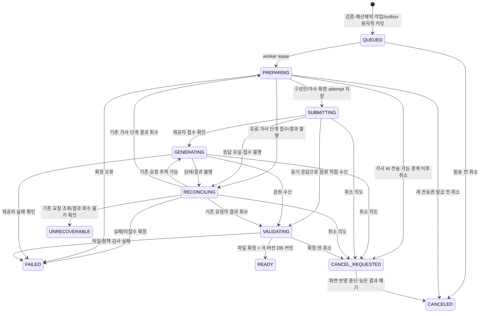

# 오늘의 트랙 · 데이터·API·생성 작업 계약

2026-11-12 · 설계 v0.2 · 기획/최신 검증 대조 리뷰 반영 · [전체 설계](README.md) · [기록과 여정](recording-and-journeys.md)

이 문서의 이름·필드·엔드포인트는 새 설계의 기준안이다. 기존 검증 코드와의 호환 계약이나 이미 배포된 API를 뜻하지 않는다. 식별자는 클라이언트에서 오프라인 발급 가능한 UUID, 시각은 UTC+필요한 IANA 시간대, 시간차는 같은 boot의 단조 시각을 사용한다. `null/unknown/unsupported`를 0으로 치환하지 않는다.

## 1. 핵심 모델과 소유권

| 모델 | 주요 필드 | 소유/변경 규칙 |
| --- | --- | --- |
| Account / DeviceLink | ownerId, ownerEpoch, deviceId, kind, profileScope, keyId, enrollmentEvidence, revokedAt | 계정 로그인과 폰 연결을 분리. 차량 종류는 서버 등록 자격으로 부여 |
| CaptureSession / Epoch | sessionId, ownerScope, captureState, bootId, epochId, lastSeq, lastCommit | 차량만 원본 기록. `(deviceId, localProfileScope)`마다 활성 writer 하나 |
| Observation / QualityEvent / Gap | eventId, seq, acquisition, environment, source/receive 시각, 값/단위, quality, policyVersion, sourceMask, 구간/확실성 | SDK/앱 계산/사용자/추론 출처와 합성/도로 환경을 별도로 보존 |
| DriveLeg | legId, sessionId, event 범위, 시작/끝 근거, gapRefs | 차량 해석 revision. 프로세스 epoch와 별개 |
| JourneyGroup / GroupSlice | groupId, kind=DAY/TRIP, zoneId, dayKey/tripId, groupRevision, sliceRefs, closeReason | 차량이 원본 귀속 관리. 서버는 요약 revision mirror |
| JourneySummary | summaryId/revision, groupRevision, orderedEvents, distances, timeMeanings, gaps, evidenceRefs, summaryHash | 차량에서 좌표 제거. 지원 상태/unknown 포함 |
| Attachment / Settings | attachmentId, targetGroupId/trackId, type, contentHash, revision, usage/consentScope / settingRevision, lyricMode, genreProfile, generationPolicy | 대상과 사용 목적을 명시. 사진/메모·자동 생성 동의 별도 |
| GenerationInputSnapshot | snapshotId, ownerId, group/sliceManifestHash, summaryRevision/hash, settings/attachment revisions, factSet, schemaVersion | 생성 의도 때 불변. 재생성도 새 snapshot에 원입력 lineage 유지 |
| CompositionPlan / LyricsDraft | planId, orderedSections, relativeWeights, allowedFactRefs, creativeText, version/hash | 사실과 창작 구별. 최종 전송본을 보존 |
| GenerationJob / Attempt | jobId, intentId, inputHash, lineageId, parentVersionId?, state, stateRevision, budgetReservationId / stage, attemptId, providerRequestId?, submissionState | 서버가 상태 전이. 가사 AI를 포함한 모든 유료 호출마다 별도 attempt |
| GenerationLineage | lineageId, ownerId, sourceCoverageHash, lineageEpoch, firstReadyJobId, inputAccessState, deletionRevision | 음원 버전 삭제와 최초 성공 자격을 분리. 입력 삭제는 자격 사용도 차단 |
| Track / TrackVersion | trackId, sourceCoverageHash, representativeVersionId / versionId, snapshotId, jobId, audioAssetId, provider/model, returnedLyrics?, integrity, adherence | 논리 곡/음원 버전·요청 가사/반환 텍스트/가창 평가를 분리 |
| Asset | assetId, kind, storageKey, sha256, mime, bytes, duration, rightsProfile, status | 비공개 객체. URL은 식별자 아님 |
| Album / AlbumEntry | albumId, ownerId, kind, title/cover, revision / entryId, trackId, versionMode, pinnedVersionId?, position | 기본 PINNED로 버전 고정, FOLLOW_REPRESENTATIVE는 선택 |
| Outbox / Change / Tombstone | mutationId, entityId, expectedRevision, cursor, deletedAt, deletionScope | 재전송·변경분 동기화·오프라인 삭제 수렴 |
| CostReservation / CostLedger | ownerId, policyId, quoteId, upperBound, reserved/settled/unknown, attemptId | 사용자/전역 예산 예약·정산. 실제 청구 확인과 추정 구별 |

`sourceCoverageHash`는 ownerId와 정규화한 `(deviceId, sessionId, [fromSeq,toSeqExclusive))` 범위 manifest만으로 계산한다. 겹친 범위를 먼저 합치고 정렬한다. groupId·요약 알고리즘·장르·메모·schema 표현 버전은 범위 정체성에서 제외하고 별도 summaryHash/inputHash에 넣는다. 따라서 같은 기록의 요약 재계산이 최초 성공 이력을 잃게 하지 않으며, 새 관측 추가는 다른 범위가 된다. 범위 정규화 규칙 변경 시 기존 lineage와 명시적 migration으로 연결하고 묵시적으로 새 범위를 만들지 않는다.

음악 제공자에는 좌표 원본·범위 manifest·원본 해시를 보내지 않는다. 차량 내부의 원본 해시, 서버에서 받은 manifest/요약 해시, 최종 요청/음원 해시를 trace 참조로 연결한다. 서버는 좌표 원본의 진실성을 재검증하는 것이 아니다. 해시는 연결 증거이며 실제 도로 주행 증명이 아니다. 합성 입력 표시는 끝까지 유지한다.

서버에는 원본 좌표 없이 `sourceCoverageHash`, 선택 범위·출처/품질·정리된 순서가 남는다. 폰의 재생성은 이 고정 사실 묶음을 재사용한다. 원본 DB를 서버에서 재계산할 수 있다고 약속하지 않는다.

사진/메모는 group/track 대상에 귀속시켜 폰에서 첫 생성 전에 추가할 수도 있다. 차량의 source 요약 업로드와 선택 입력 revision 동기화는 별개다. snapshot은 완료된 첨부의 **내용 해시·revision·허용 용도**를 참조하며 변하는 다운로드 URL을 inputHash에 넣지 않는다. SDK 사실, 사용자 진술, 사진 추정, 창작 표현을 factSet 내부에서도 분리한다. 사진 분석은 별도 동의가 있을 때만 실행하며 단순 커버 선택이 외부 AI 분석 동의가 되지 않는다.

## 2. 버전과 변경의 의미

- `schemaVersion`, `capturePolicyVersion`, `inferenceVersion`, `summaryVersion`, `plan/lyrics/promptVersion`, `providerAdapterVersion`, `provider/modelId`, `settingsRevision`, `requestHash`, `audioHash`를 연결한다. 제공자가 모델 revision을 공개하지 않으면 실제 요청 ID/날짜와 `revision=unknown`을 남긴다.
- 본문은 정규 JSON·단위·배열 순서 규칙을 정해 해시한다. 문자열 포맷 차이로 의도치 않은 다른 입력이 되지 않게 한다. secret/header는 해시 추적 본문에 포함하지 않는다.
- 생성 요청의 입력은 불변이다. 원본 추가/가사·장르·선택 입력 변경은 새 snapshot, 새 job, 새 version을 만든다. 같은 입력·seed로 같은 음원이 나온다는 보장은 없다.
- 제목·커버·앨범 순서는 metadata revision으로 수정하며 음악 재생성/과금과 분리한다. 커버는 기본 그래픽·선택 사진으로 만들 수 있으며 유료 이미지 생성은 기본 흐름에 추가하지 않는다.
- 곡 버전은 이전 것을 보존하고 완료 후 새 버전을 대표로 제안한다. 생성 요청 당시의 대표 포인터 revision이 그대로일 때만 자동 대표 전환한다. 다른 기기에서 선택이 바뀌었으면 새 버전을 추가하고 선택을 묻는다. 제목/커버가 대기 중 바뀌었어도 AI 제안으로 덮지 않는다.
- Room migration은 버전별 이전과 원본 보존 검증, 서버 `/v1`은 추가 필드 허용·명시 enum unknown 처리. 필수 계약 불일치는 `CLIENT_UPGRADE_REQUIRED`로 생성만 보류하고 로컬 기록/기존 곡 재생을 보존한다. snapshot을 몰래 최신 schema로 바꾸지 않는다.

## 3. 묶음·작업·다운로드 상태

묶음은 `OPEN → CLOSE_CANDIDATE → SEALED`로 이동한다. 사용자 계속 기록은 후보→OPEN, SEALED의 추가 기록은 새 groupRevision으로 연다. 삭제는 별도 tombstone이다. SEALED 자체는 생성/과금 동의가 아니다. 생성은 snapshot에 걸려 있으므로 하나의 group `generated=true` 플래그로 표현하지 않는다.

일반 첫 생성은 SEALED revision만 선택한다. ‘원하는 기간’은 열린 여행 전체를 강제 종료하는 대신 선택한 범위만 불변 manifest로 확정해 snapshot을 만든다. 진행 중인 leg의 범위를 확정하는 조작도 정차 중에만 허용하며 이후 관측은 해당 snapshot에 자동 추가되지 않는다.

입력/권한/요금 조건을 통과하지 못한 요청은 작업을 만들지 않고 거절 사유를 반환한다. 사용자 화면은 상태들을 접수·준비·생성·저장·완료·확인 중·실패·취소로 단순화한다. `UNRECOVERABLE`은 ‘결과 복구 불가’로 표시하고 비용 미결이면 ‘비용 확인 중’을 함께 표시한다. 실패는 `failureStage`, `retryDisposition`, `providerAcceptance`, `costStatus`를 가진다. 예산 보류/인증 만료·권한 오류·지원 안 됨과 네트워크 문제를 동일 ‘다시 시도’ 버튼으로 처리하지 않는다.

`PREPARING`의 가사 AI도 외부 송신 전 attempt를 저장한다. 단계 결과를 durable 저장한 뒤 다음 단계로 넘어가며 worker 복구 때 완료된 유료 단계를 재호출하지 않는다. `RECONCILING`에는 `stage`와 복귀 상태를 기록한다. 취소/삭제 fence는 음악뿐 아니라 모든 유료 단계의 새 송신을 차단한다.

전송 가능 경계는 취소/삭제/예산을 확인하고 해당 attempt의 `SUBMITTING`을 커밋한 때다. 경계 전 취소는 새 호출을 막고 미사용 예약만 반환한다. 경계 뒤에는 소켓 송신 시점과 취소가 완전히 원자적일 수 없으므로 ‘전송됐을 수 있음’으로 취급한다. 음악 전송 전이어도 이미 실행한 가사 AI 비용은 별도로 남는다.

`UNRECOVERABLE`은 ‘기존 결과를 회수할 수 없음’이지 미과금 확정이 아니다. 제공자가 조회·멱등·취소를 지원하지 않는 경우에도 사용할 수 있는 종료 경로다. 이전 attempt의 비용은 UNKNOWN/예약 상태로 남겨 가용 예산에 계속 반영하고, 뒤늦게 결과가 와도 종료된 job을 자동 공개하지 않는다. 새 음악을 원하면 중복 과금 가능성을 고지한 별도 intent와 추가 비용 예약이 필요하다. 기존 결과 미확인을 일반 실패로 위장하거나 예산을 시간 경과만으로 반환하지 않는다.

클라이언트 발신 상태 `LOCAL_PENDING/SENDING/ACKED`는 서버 작업 상태와 별개다. 음원도 서버 `READY`와 기기 `NOT_DOWNLOADED/DOWNLOADING/AVAILABLE/CORRUPT`를 나눈다. 차량이 꺼지거나 다운로드가 실패해도 서버 생성 작업을 다시 만들지 않는다. DB 실패로 객체만 남으면 job/attempt ID로 회수·정리하고 새 AI 호출하지 않는다.

제공자 어댑터는 `supportsIdempotency/query/cancel/webhook`, `resultMode=INLINE/ASYNC`를 명시한다. INLINE은 요청을 받는 즉시 성공 응답 본문을 제한된 임시 저장에 보존하고 검사 단계로 넘긴다. 원본 응답의 메모리 소실 전에 저장하지 못한 장애는 회수 불능일 수 있다. 현재 Lyria probe가 결과를 직접 받은 사실만으로 장기 작업 ID·조회·취소·webhook까지 지원한다고 가정하지 않는다. [Lyria 공식 생성 예시](https://ai.google.dev/gemini-api/docs/music-generation)

## 4. 주요 API 기준안

공통: TLS·계정 인증·소유권 검증. 생성 관련 mutation에는 `Idempotency-Key`와 payload hash, 편집에는 `If-Match: revision`. 소유자 없는 다른 기기 접근을 entity UUID만으로 허용하지 않는다. 생성 응답 `202`는 jobId/stateRevision, 같은 key 재전송은 기존 결과. key는 같고 본문이 다르면 `409 IDEMPOTENCY_CONFLICT`. idempotency key는 owner+operation으로 scope한다.

| API | 계약 |
| --- | --- |
| `POST /v1/auth/challenges` / `.../{id}/complete` | 정차 차량의 계정 로그인용 일회성 브라우저 코드. 별도 폰 앱 설치/연결 없이 이용 가능 |
| `POST /v1/device-links/challenges` / `.../{id}/approve` / `DELETE /v1/device-links/{id}` | 일회성 연결 요청·폰 인증과 차량 승인·해제. 기기 종류는 연결 자격에서 결정 |
| `GET /v1/device-links/{id}/status` | 등록 기기 키 증명으로 연결/해제 상태만 조회. revoked도 확인 가능하나 콘텐츠·새 인증 token은 반환하지 않음 |
| `PUT /v1/journey-groups/{id}/revisions/{revision}` | 차량만 source manifest·좌표 없는 요약 업로드. 같은 revision 다른 hash 거절 |
| `POST /v1/input-snapshots` | 정확한 summary/settings/attachment revisions를 고정. 차량 첫 생성/폰 재생성 자격 검증 |
| `POST /v1/generation-quotes` | snapshot·출력 형태·제공자 profile의 비용 상한/가능 여부·만료 quote 발급 |
| `POST /v1/generation-jobs` | intentId, snapshotId, quoteId, intent=`INITIAL/REGENERATE`, lineageId?, parentVersionId?, 차량 서명 의도/자동정책 revision. 원자적 예약·작업 생성 |
| `GET /v1/generation-jobs/{id}` | stateRevision·단계·실패/비용 상태·완성 versionId. ETag/Retry-After로 제한 조회 |
| `POST /v1/generation-jobs/{id}/cancel` | 멱등 취소. 이미 READY이면 취소 불가와 버전 반환, 삭제는 별도 |
| `GET /v1/tracks` / `GET /v1/tracks/{id}/versions` | 소유 곡·이전 버전·가용성/권리/재생성 가능 여부 |
| `PATCH /v1/tracks/{id}` / `PATCH /v1/albums/{id}` | 제목/커버·대표 버전·앨범 항목/정렬, expected revision. AI 호출 없음 |
| `POST /v1/albums` | 기존 track refs와 순서로 모음 생성. 날짜별 새 곡 생성은 별도 job들 |
| `POST /v1/attachments` / `.../{id}/complete` | 선택 메모/사진 revision, 업로드 허용 크기·형식·권한 검사. 미완료 첨부는 snapshot에서 제외/대기 선택 |
| `GET/PATCH /v1/settings` | 설정 revision 충돌 감지. 폰에서 켠 자동 생성은 차량 동기화·확인 전 효력 없음 |
| `GET /v1/sync?cursor=...` / `POST /v1/sync/ack` | 소유자 변경분·tombstone·다음 cursor, 적용 후 확인 |
| `POST /v1/assets/{id}/download-grants` | 권리/소유권 확인 후 짧은 다운로드 권한·해시·range 지원 정보. URL 로그 금지 |
| `POST /v1/shares` / `DELETE /v1/shares/{id}` | 범위 선택·만료·해제. 공개 원본 경로 없음 |
| `POST /v1/deletion-requests` / `GET /v1/deletion-requests/{id}` | scope=`LOCAL_RAW/INPUTS/TRACK/ALBUM/ACCOUNT`, 대상·예상 revision·삭제 진행. 로컬 삭제는 해당 기기 명령으로 전달 |

차량 서명 의도는 deviceId·ownerId·snapshotHash·settings/policyRevision·intentId·유효기간을 묶고, 서버 등록 기기 키로 확인한다. APK의 비밀 문자열이나 본문의 `origin=car`를 신뢰하지 않는다. 이것은 서버 권한 경계이며 일반 기기 서명을 하드웨어 무결성 증명으로 과장하지 않는다. 정차 여부는 차량 플랫폼에서 확인하며 서버가 서명만으로 물리 정차를 검증했다고 표시하지 않는다.

등록 자격의 부트스트랩은 V1/V3 확인 항목이다. 클라이언트가 keypair와 `kind=CAR`를 제출했다는 이유만으로 차량 권한을 발급하지 않는다. 개발 에뮬레이터는 명시적으로 등록한 개발용 기기만 허용하고 개발/서비스 환경 자격을 분리한다. 서비스의 차량 등록 증거는 Pleos 배포/플랫폼이 제공하는 확인 경로를 조사해 정한다. 그 경로가 없으면 등록된 폰의 오용은 막을 수 있어도 변조 앱까지 판별하는 보장은 할 수 없음을 한계로 남긴다. 음악 제공자 키 보호는 이 판별의 성공과 무관하게 항상 서버에서 수행한다.

**첫 생성 정책:** 서버는 동일 `sourceCoverageHash`의 차량 시작 `GenerationLineage.firstReadyJobId`와 접근 가능한 입력을 확인해야 폰의 `REGENERATE`를 허용한다. 최초 작업 실패/취소/회수 불능만 있으면 첫 성공 전이므로 차량에서 재요청한다. 폰은 기존 snapshot의 SDK 사실/source 범위를 고정하고 장르·가사·선택 입력만 변경할 수 있다. 새 사용자 진술은 출처를 구분하고 SDK 사실을 바꾸지 않는다. groupId를 바꾸거나 새 관측을 섞거나 기존 곡 범위를 미생성 날짜로 분할해 자격을 얻지 못한다.

곡만 삭제하고 입력을 보존했다면 음원과 분리된 lineage의 최초 성공 이력으로 폰 재생성을 허용한다. 이 경우 삭제된 음원 ID가 필수 `parentVersionId`여서는 안 되며 `lineageId`와 보존된 snapshot을 사용한다. 입력 삭제/접근 차단 상태면 최초 성공 이력만으로 허용하지 않는다. 단순 제목/커버·앨범 변경은 이 자격 검사나 AI 호출이 필요 없다.

예시 요청은 `intentId=I9, snapshotId=S12, quoteId=Q7, intent=REGENERATE, lineageId=L2, parentVersionId=V3`이다. 외부 음악 제공자 키·좌표·기기 공유 경로는 포함하지 않는다. 서버는 고정 입력의 소유권과 V3의 lineage를 재검증한다. 요금/권리 불충족은 작업 생성 전에 차단하며 같은 입력의 새 음악을 의도적으로 원할 때만 새 intent/key를 발급한다.

## 5. 동기화와 경합

**결정 C1:** 서버가 곡·작업·앨범·공유·설정의 권위 저장소, 차량이 원본·구간 귀속의 권위 저장소다. 앱은 local DB/outbox로 오프라인 변경을 보존하고 재연결 시 동일 mutationId를 보낸다. 단말 wall clock의 last-write-wins는 사용하지 않는다.

서버는 변경/작업 생성과 change/outbox를 같은 DB transaction에 기록한다. 클라이언트는 한 page를 로컬 transaction으로 적용한 뒤 cursor를 저장한다. push는 가능한 환경에서 갱신 힌트로만 사용하고 반드시 서버 조회로 복원한다. FCM 부재에도 앱 재진입·제한된 backoff 조회로 수렴한다. 유휴 상태의 무한 빠른 폴링은 하지 않는다.

동기화 cursor는 서버의 소유자 범위 **커밋 순서**이며 단말 시각이 아니다. DB sequence 발급 순서만 쓰면 낮은 번호 transaction이 늦게 커밋돼 이미 넘긴 cursor 아래로 변경이 빠질 수 있다. 작은 서버에서는 owner별 cursor row를 잠근 짧은 transaction에서 entity 변경·cursor 증가·change/outbox 추가를 함께 커밋한다. 업로드/AI 대기 동안 그 잠금을 잡지 않는다. PostgreSQL sequence와 transaction의 차이는 [공식 격리 문서](https://www.postgresql.org/docs/current/transaction-iso.html)를 참고한 설계 판단이다.

page는 같은 ownerEpoch의 확정된 변경 범위를 반환하고, 앱이 적용한 page의 cursor만 ack한다. 전체 resync는 기준 cursor를 포함한 일관된 목록을 받고 그 뒤 변경분을 이어 받는다. 삭제/권한 해제도 같은 변경 흐름으로 전달한다. 계정 연결 시 미연결 로컬 scope를 묵시적으로 합치지 않고 선택 범위를 안정된 source ID로 재전송 가능하게 귀속한다. 네트워크를 가로지르는 하나의 분산 transaction으로 표현하지 않는다.

같은 revision에서 다른 기기의 제목/대표 버전/앨범 순서가 바뀌면 `409 REVISION_CONFLICT`로 최신본과 사용자의 초안을 보여준다. 변경 필드가 겹치지 않음이 증명될 때만 재적용한다. 앨범 순서처럼 여러 항목이 연결된 편집은 한 revision의 transaction이다. 사진/메모도 revision을 고정해 생성 중 편집과 섞이지 않게 한다.

삭제 tombstone은 낡은 오프라인 수정보다 우선한다. tombstone 보관 만료 뒤 돌아온 기기는 `RESET_REQUIRED`로 전체 현재 목록을 다시 받으며 과거 outbox를 자동 부활시키지 않는다. 서버는 해제 기기의 일반 token/콘텐츠 권한을 폐기하고 새 연결 전 동기화를 거절한다. 단말의 키 폐기는 아래 해제 확인·로컬 정리 뒤 수행한다. 폰과 차량이 모두 오프라인인 동안의 편집·삭제는 대기임을 표시한다.

해제 기기의 콘텐츠 접근은 즉시 막되, 기기 상태 조회는 등록키 증명으로 `REVOKED`와 로컬 정리 지시만 반환할 수 있게 한다. 앱은 해제 확정 뒤 해당 ownerEpoch의 token·캐시·outbox를 지우고 키를 폐기한다. 일반 token 만료/통신 오류만으로 보관곡을 지우지 않는다. 로컬 로그아웃은 그 기기에서 즉시 정리한다. 오프라인 기기가 다시 서버에 닿기 전 원격 삭제는 미완료이며 새 계정 로그인으로 이전 사용자의 사본을 노출하지 않는다.

## 6. 생성 실패·중복·취소·재생성

**결정 C2:** 클라이언트 요청은 재전송 가능하게 만들되, 외부 유료 호출의 exactly-once는 보장하지 않는다. DB row lease만으로 응답 유실 후 중복 과금을 막을 수 없기 때문에 attempt와 제공자 접수 확실성을 별도 보존한다.

1. 작업 수락 transaction에서 권한·삭제 fence·동일 활성 intent·quote/policy·예산을 잠그고 예약·job·outbox를 생성한다. 같은 snapshot/profile/intent의 중복 클릭은 활성 job에 합류시킨다. 여러 날 배치도 child별 고유 key를 사용한다.
2. worker는 lease/fencing token으로 한 상태 전이만 소유한다. 외부 송신 전 `attemptId`, requestHash, 최대 비용, `SUBMITTING`을 durable 저장한다. worker가 죽으면 새 worker는 그 attempt를 먼저 조정하며 곧바로 재송신하지 않는다.
3. 제공자가 멱등 key/조회 ID를 지원하면 attempt ID와 연결해 기존 요청을 조회/회수한다. 지원하지 않거나 접수 여부가 불명이면 `RECONCILING`, 사용자에게 ‘생성 결과 확인 중, 다시 생성하면 비용이 추가될 수 있음’을 표시한다. local timeout은 미접수 증거가 아니다. 이 상태를 timeout만으로 실패/예약 해제로 바꾸지 않는다.
4. webhook은 지원할 때만 서명·timestamp/replay·providerRequestId를 검증한다. 이벤트 ID로 중복을 제거하고 서버의 stateRevision/fence를 비교해 허용된 전이만 적용한다. 제공자 이벤트 순서 번호가 없다면 수신 순서를 실제 진행 순서로 간주하지 않으며 READY/취소/삭제 상태를 과거 RUNNING으로 되돌리지 않는다. 불명확하면 조회한다. 결과 다운로드 실패는 같은 결과만 재다운로드하고 음악을 다시 생성하지 않는다.

| 실패/조작 | 정책 |
| --- | --- |
| 인증·결제·예산·지원 오류 | 자동 재시도 없음, 해당 원인 해결 안내 |
| 요청 전 일시 네트워크·제공자 명시 미접수 | policy의 유한 backoff 범위 내, 매번 예산 재확인. 무한 재시도 없음 |
| 송신 뒤 5xx/timeout | 접수 불명으로 조정. 상태 조회 가능성부터 확인, 무조건 새 POST 금지 |
| MP3 깨짐·다운로드 실패 | 원 결과 회수/재다운로드. 새 음악 요청은 새 승인된 intent/비용 예약 필요 |
| 가사 사실 검사 실패 | 음악 호출 전 수정/중립 템플릿/확인. 가사 AI 수정도 비용 한도에 포함 |
| READY 이후 실제 가창·무가사/전개 불만족 | 기술적 파일 성공과 구별. 새 버전 제안은 가능하나 자동 유료 재생성 금지 |
| attempt 전송 가능 경계 전 취소 | 취소 fence 후 새 호출 안 함, 미사용 예약만 반환. 완료된 다른 단계 비용 유지 |
| 경계 뒤 취소 | 실제 미송신을 입증 못하면 전송 가능으로 취급. provider cancel 가능하면 요청. 결과 공개 중단과 과금 취소는 별개, 늦은 음원은 대표/앨범에 추가하지 않고 정리 |
| 재생성 | 새 snapshot/job/version·새 비용. 이전 곡은 재생 가능하게 보존, 재감상은 저장 파일 사용 |

취소 transaction이 READY 커밋보다 먼저면 완료 쪽이 cancel/delete fence를 확인하고 공개하지 않는다. READY가 먼저면 취소 API는 이미 완료라고 반환하고 삭제 경로를 제공한다. CANCELED 뒤에도 attempt 원장에는 제공자 미결 비용이 남을 수 있으며 늦은 결과·청구를 조정하는 서버 작업은 계속 필요하다. ‘취소됨’은 사용자 콘텐츠 처리 상태이지 환불 확정이 아니다.

## 7. 비용 통제와 키 보호

**결정 C3:** 사용자/기기/전역의 동시 작업 수·일/월 예산·작업 최대 비용을 서버 정책으로 제한한다. 값은 실제 제공자 profile·사용자 승인 범위에서 정한다. 이 문서가 횟수·금액을 새로 승인하지 않는다. 현재 실험 원장은 4요청(402 거절 1, 생성 3)이며 추가 승인 잔여량 0이다.

생성 quote는 음악뿐 아니라 선택 가사 AI·허용 재시도·필요 저장/전달 추정을 분리한다. 원가 예상과 사용자 요금은 별개다. 유효한 상한을 정할 수 없으면 자동 유료 dispatch를 보류한다. 예약은 동시성 잠금 아래 가용 예산에서 차감한다. 불명 접수의 예약은 임의 시간 경과로 반환하지 않는다. 제공자 사용량/실제 청구가 지연되면 `costStatus=UNKNOWN/ESTIMATED`로 남긴다. 실패·취소 요청도 비용 발생 가능성이 있다.

기간 선택/여행 날짜별 앨범은 곡 수와 총액 상한을 한 번 보여주고 child별 예약한다. 부분 실패는 성공한 곡만 남기며 누락 child만 재개한다. 묶음 설정 동의와 유료 생성 동의를 합치지 않는다. 자동 생성은 승인된 policy의 owner·대상·settings revision·비용 cap·만료를 기록하고, dispatch 직전에 중지/예산/삭제 여부를 다시 확인한다. 오프라인 발신 대기 intent가 만료/비용 변경이면 새 확인으로 되돌린다. 한 번 누르기 기본 흐름에서는 사전에 고지한 한도 내 quote를 자동 적용하고 범위 밖에서만 추가 확인한다.

**오프라인 한 번 누르기:** 차량은 선택 source 범위·설정/첨부 revision·intentId·허용 비용/만료를 로컬 outbox에 먼저 고정한다. 재연결 때 요약→snapshot→quote→job을 같은 intentId에 연결해 재전송한다. 최신 설정이나 새 메모를 조용히 섞지 않는다. 사전 승인 한도/유효기간을 충족하는 quote만 자동 접수하며 그 밖은 차량의 확인 대기로 둔다. 폰에서 이 대기 건을 첫 생성으로 승인할 수 없다.

자동 생성 끄기는 서버 정책 revision을 폐기하고 발송 전인 자동 intent를 취소한다. 차량/폰의 오프라인 끄기는 서버 반영 전까지 ‘중지 동기화 대기’이며 이미 접수된 호출 취소와 구분한다. 재연결 시 서버의 최신 폐기 revision이 오래된 차량 intent보다 우선한다. 수동 재생성 intent까지 자동으로 취소하지 않는다.

제공자 API 키는 서버 secret manager에서 worker에 최소 권한으로 전달한다. APK/폰/리포지토리/클라이언트 config/분석 로그에 저장하지 않는다. 기존 PC DPAPI 검증 키 저장 방식은 개발 probe의 보호 수단이며 제품 비밀키 배치안이 아니다. 키 회전·폐기와 전역 dispatch kill switch를 제공한다. 클라이언트에는 짧은 access token·회전 refresh token·등록 기기 자격만 둔다. 인증 token·다운로드 URL·prompt/가사·제공자 응답 전문을 오류 로그에 덤프하지 않는다.

공급자 요청은 서버에서 크기/길이/형식 제한을 적용하고 모델 URL·저장 위치를 클라이언트가 지정하게 하지 않는다. 결과 URL을 제공자가 반환하는 경우 허용 host/HTTPS/크기 제한으로 가져온다. 첨부/메모 안의 명령·외부 URL을 자동 실행하거나 추가 도구/요청을 발생시키지 않는다.

## 8. 삭제와 보존

삭제는 `REQUESTED → SERVER_TOMBSTONED → ASSETS_PURGED → DEVICES_PENDING/COMPLETE`로 추적한다. 대상이 로컬 원본뿐이면 서버 음원 purge 단계는 적용하지 않는다. 기기/백업/제공자 삭제 상태는 독립 필드이며 하나라도 확인되지 않으면 전체 완료로 보고하지 않는다.

| 범위 | 처리와 경계 |
| --- | --- |
| 차량 원본만 | 해당 범위 수집 중단 또는 새 session 전환 후 로컬 삭제·체크포인트 정리. 기존 요약/곡 보존 여부 설명 |
| 생성 입력 | summary·snapshot·plan·요청/반환 가사 텍스트·선택 첨부/파생본 삭제, 미래 재생성 차단. 곡만 보존하려면 의미 있는 기록 요약도 제거하고 최소 음원 메타데이터만 유지 |
| 곡/버전 | 작업 취소 fence·음원/커버 권한 회수·앨범 참조 정리·기기 캐시 삭제 요청. 다른 버전의 공용 asset 참조는 reference count 확인 |
| 앨범 | 모음/항목/앨범 전용 커버 삭제, 곡은 유지 |
| 계정 전체 | 새 요청 차단→모든 작업 fence→입력/곡/앨범/첨부/공유/연결 삭제→기기 사본 요청·제공자 삭제 요청/결과 추적 |

**삭제 후 재업로드 방지:** 입력 삭제는 snapshot ID 하나가 아니라 lineage/source 범위에 `deletionRevision`을 남겨 기존 폰·차량 snapshot/outbox·재요약 업로드도 거절한다. 원본을 차량에 남긴 선택이라도 오래된 대기 요청이 자동으로 입력을 되살릴 수 없다. 같은 범위에서 다시 만들기는 차량에서 ‘삭제한 입력을 다시 만들기’를 명시적으로 선택한 새 INITIAL 의도로만 가능하며 삭제 revision과 새 동의를 연결한다. 이때 같은 sourceCoverageHash에 새 `lineageEpoch/lineageId`를 만들고 최초 READY 자격은 새로 얻는다. 삭제된 옛 lineage의 성공 이력으로 새 입력의 폰 생성을 열지 않는다. 이는 삭제 취소나 과거 입력 복원을 뜻하지 않는다. 계정 전체 삭제 후 새 계정은 다른 ownerEpoch이며 과거 outbox를 승계하지 않는다.

입력 삭제 후 음원을 보존하면 소리·제목·커버 자체에도 장소/메모가 남아 있을 수 있음을 안내한다. ‘곡까지 함께 삭제’ 선택을 제공하고, 보존 음원이 기억 내용을 담고 있다는 사실을 요약 데이터 삭제와 혼동하지 않는다. 여러 snapshot이 공유하는 첨부는 삭제 범위의 참조를 모두 끊은 뒤 정리하며, 개별 사진/메모 삭제도 해당 원본·파생본과 이를 보존한 입력들의 삭제 영향을 안내한다.

**결정 C4:** 삭제 요청과 job/곡 상태 변경은 같은 소유자 범위 transaction/fence로 경합한다. 처리 중 worker가 이미 입력을 읽었거나 외부에 전송했으면 전송을 되돌릴 수 없고 제공자 보존/삭제 정책을 적용한다. 늦은 응답은 음원 등록 전 tombstone을 확인해 폐기하며 다운로드 권한을 발급하지 않는다. 서명 URL은 만료 전 완전 회수가 어려울 수 있으므로 짧은 grant와 private proxy를 검토하고, 공유 링크는 서버 권한 확인을 매번 적용한다.

원본과 요약을 지우더라도 잔여 비용 정산에 필요한 최소 attempt/tombstone·비용 금액·익명화되지 않은 계정 연계 범위를 명시적으로 정해야 한다. 입력 전문·좌표·메모를 정산 명목으로 보존하지 않는다. 법적/운영상 보존 기간은 미결이며 출시 전 고지와 실제 purge/백업 만료 정책을 맞춘다. 이 문서는 법률 적합성 확인 결과가 아니다.

연결 해제는 서버 접근 취소와 앱 관리 캐시 정리를 뜻하며 계정 전체 곡 삭제와 구별한다. 오프라인 기기의 앱 사본 삭제는 다음 연결/재인증 때 수행한다. 외부 내보내기 파일·받는 사람이 저장한 공유 파일은 회수할 수 없다. 앱 내 삭제 완료와 외부 사본 통제를 혼동하지 않는다.

## 9. 계약을 확인할 핵심 시나리오

후속 구현에서는 아래 결과를 API/DB/사용자 화면을 함께 관찰해 확인한다. 자체 대역으로 통과한 것과 실제 SDK/AI/기기 실행을 각각 기록한다. 테스트 구현은 이번 요청에 포함하지 않는다.

| 시나리오 | 확인할 사용자 결과 |
| --- | --- |
| 차량 생성 버튼 두 번·서버 응답 유실 뒤 재연결 | 같은 job 반환, 불명 외부 요청은 재송신되지 않음 |
| worker가 유료 요청 직후 죽음 | attempt 회수·RECONCILING, lease 만료만으로 새 음악 호출 안 함 |
| 최초 요청 실패 뒤 폰 재생성 요청 | 차량 최초 성공까지 거절, 기존 READY 이후는 허용 |
| 기존 곡+새 주행 범위를 폰에서 합쳐 요청 | source 범위 검증으로 차단, 차량 첫 생성으로 안내 |
| 생성 중 폰 메모/제목·대표 버전 변경 | 고정 입력과 최신 metadata 분리, 완료가 사용자 편집 덮지 않음 |
| 취소/삭제 후 성공 callback, 역순·중복 webhook | 음원/앨범 부활 없음, 비용은 별도 확인 |
| 같은 계정의 여러 작업·날짜별 배치·예산 경합 | 예약 상한 유지·부분 성공 보존, 미승인 child 자동 생성 안 함 |
| 서버 READY 뒤 차량 꺼짐/손상 다운로드 | 같은 음원 회수·재다운로드, AI 재호출 없음 |
| 오프라인 편집 뒤 다른 기기 삭제·오래된 cursor | tombstone 우선·전체 resync, 콘텐츠 부활 없음 |
| 다른 계정 ID·해제 기기·가짜 origin=car | 접근 거절, 새 기록 최초 생성 우회 불가 |
| 입력 삭제 뒤 재감상/재생성 | 음원 보존 선택이면 감상 가능, 재생성은 불가로 안내 |
| 동일 기록 요약 버전 변경·겹친 slice | 범위 정체성 유지·중복 합산 없음, 새 관측 추가는 차량 첫 생성 |
| 가사 AI 직후 worker 종료·INLINE 음원 응답 유실 | 유료 단계별 attempt 복구, 조회 불가면 회수 불능/비용 미결을 분리 |
| cursor 10 transaction 지연·11 먼저 커밋 시도 | owner commit 순서 직렬화로 변경 누락 없음 |
| 연결 해제 후 token 사용 거절 | 콘텐츠 거절·해제 상태만 확인·앱 사본 정리, 일반 인증 만료와 구분 |
| 입력 삭제 후 차량에서 요약/오프라인 intent 재전송 | 삭제 revision 우선, 사용자의 명시적 새 생성 전에는 부활 없음 |
| 여행 전체 곡 뒤 날짜별 앨범 생성 | 미생성 범위는 차량 요청, 기존 날짜 곡 재사용·앨범 버전 고정 |

완료 판단은 이 계약뿐 아니라 [전체 설계의 V1~V6](README.md#9-개발-순서와-검증)의 실제 사용자 흐름 증거와 연결한다. API 설계·대역 통과·배포 성공만으로 전체 제품 완료를 선언하지 않는다.
