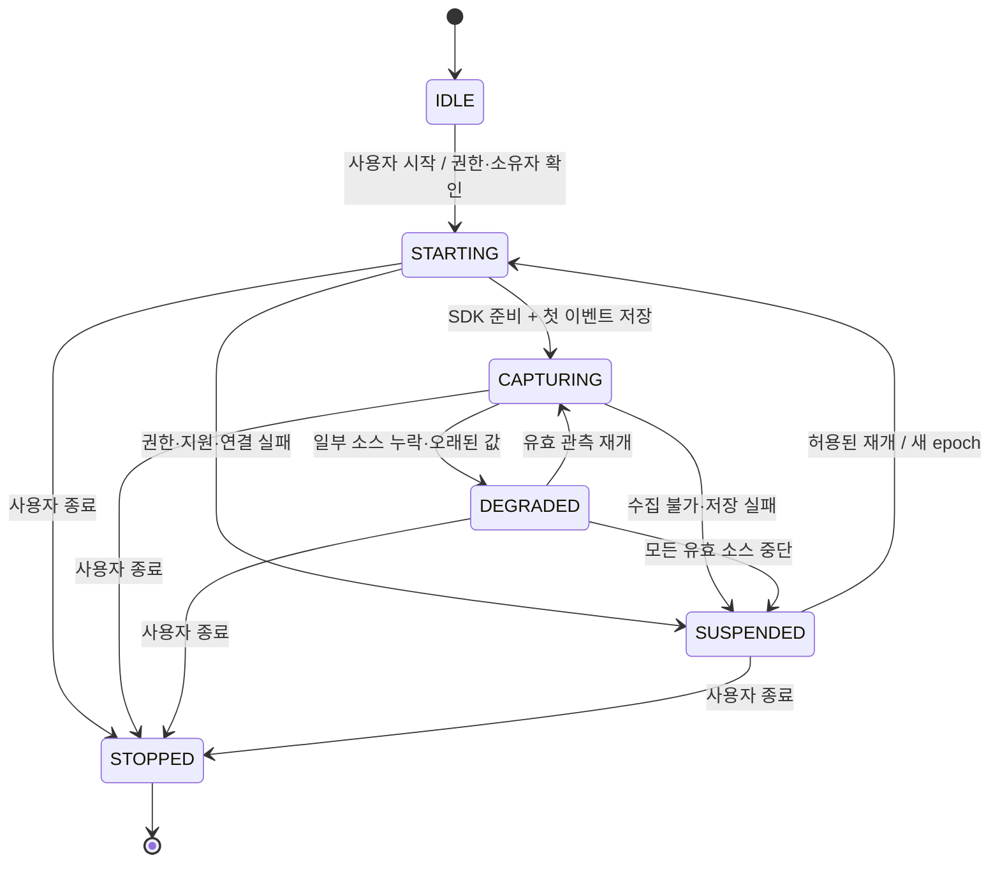

# 오늘의 트랙 · 기록과 여정

2026-11-12 · 설계 v0.2 · 기획/최신 검증 대조 리뷰 반영 · [전체 설계](README.md) · [데이터/API](data-api-and-jobs.md)

## 1. 개념과 불변 조건

| 개념 | 의미 | 다른 개념과의 관계 |
| --- | --- | --- |
| CaptureSession | 사용자가 허용한 수집 의도와 소유자 범위 | UI·프로세스·시동과 독립. 여러 실행 구간 포함 가능 |
| CaptureEpoch | 같은 부팅에서 SDK가 연결돼 있던 수집 실행 구간 | 프로세스/SDK 재연결 시 새 epoch. 장치 boot ID와 연결 |
| Observation | 출처·시각·품질이 있는 SDK 원본 이벤트 | 위치와 거리 이벤트는 비동기로 개별 보존 |
| Gap | 연속 관측을 주장할 수 없는 범위 | 중단·권한·SDK 오류·오래된 값·저장 실패 등을 명시 |
| DriveLeg | 실제 이동의 시작/종료 또는 사용자가 정한 주행 구간 | epoch와 동일하지 않음. 중단 뒤 같은 leg에 gap을 포함할 수 있음 |
| JourneyGroup | 하루 또는 여행이라는 기록 묶음 | 한 개 이상 leg 범위 참조. 여러 날 여행도 한 묶음 |
| GenerationInputSnapshot | 선택한 묶음 범위와 사실 요약의 고정본 | 곡 생성 입력. 이후 원본 증가·묶음 수정과 독립 |
| Track / Album | 음악 결과와 기존 곡의 모음 | 묶음/구간을 대신하지 않음 |

**확정:** 기록하지 못한 이동을 사실로 채우지 않는다. **결정:** 주행 구간 종료·하루/여행 마감·음악 생성은 별도 사건이다. 정차 하나로 곧바로 여행 종료/유료 생성하지 않는다. 이동·머묾·귀환은 출처와 확신 수준을 동반하는 해석이며 감정 측정이 아니다.

## 2. 수집 수명주기와 실행 주체

**결정 R1:** UI Activity/ViewModel은 시작·중지 명령과 상태 표시만 담당한다. `JourneyCaptureService`가 수집 범위 coroutine·SDK 어댑터·단일 저장 writer를 소유한다. 위치/Vehicle 연결을 서비스에서 획득해 한 번만 등록하고, SDK 연결 끊김 때 재연결 epoch를 연다. UI 재생성·다중 창 전환으로 listener가 중복 등록되지 않게 한다. 정상 중지 시 listener 해제→진행 중 쓰기 종료→체크포인트→SDK release. `onDestroy` 호출은 복구의 전제가 아니다.

Pleos는 `FusedLocation.initialize()` 후 조회/콜백 등록, 사용 종료 시 listener 해제와 `release()`를 구별한다. 이 수명주기를 수집 소유자 범위로 적용한다. 서비스에서의 지속 사용 가능성은 별도 검증 대상이다. [Pleos 초기화/해제](https://document.pleos.ai/docs/pleos-only/connect-sdk-pleos/FusedLocation/initialization-and-release)

**결정 R2 — 첫 후보는 사용자 시작 foreground service.** 정차 중 보이는 화면에서 시작하고 수집 중 알림/상태와 중지 경로를 유지한다. Android `location` foreground service에는 해당 타입·기본 FGS 선언, target/OS에 맞는 `FOREGROUND_SERVICE_LOCATION`, 위치 서비스/런타임 권한 조건을 확인한다. 백그라운드에서 새 서비스를 시작하는 것은 별도 제한이 있으므로 WorkManager/부팅 receiver로 우회한다고 가정하지 않는다. [서비스 타입](https://developer.android.com/develop/background-work/services/fgs/service-types#location), [백그라운드 시작 제한](https://developer.android.com/develop/background-work/services/fgs/restrictions-bg-start)

**가정/검증 필요:** Pleos는 `pleos.car.permission.FUSED_LOCATION` dangerous 권한을 정의하지만 Android 위치 권한·백그라운드 정책과의 관계를 보장하지 않는다. 따라서 위 일반 Android 선언을 Pleos SDK의 충분조건으로 간주하지 않는다. V1에서 실제 이미지/target별 필요한 선언·런타임 요청·서비스 시작 오류·콜백 지속을 기록하고 최종 권한 조합을 정한다. 권한이 있다고 데이터가 신선하게 오는지도 따로 확인한다. [Pleos 권한·정책 경계](https://document.pleos.ai/docs/pleos-only/connect-sdk-pleos/FusedLocation/declaring-permissions)

V1은 **서비스 시작 허용·SDK 권한 허용·신선한 콜백 지속**을 각각 관찰한다. `location` 타입을 쓰면 일반 Android가 요구하는 위치 권한도 실제로 충족해야 하며 Pleos 전용 권한 하나로 대체된다고 가정하지 않는다. 반대로 권한만 추가했다고 Pleos가 백그라운드 수신을 허용한다고 결론 내리지 않는다. 타입/권한이 맞지 않으면 무관한 서비스 타입으로 우회하지 않고 플랫폼이 허용하는 구조를 확인한다.

WorkManager는 네트워크 복귀 후 요약 업로드·상태 동기화·다운로드 같은 **지연 가능한 작업**에 사용한다. 끊김 없는 SDK 수집기나 정확한 자정 타이머로 사용하지 않는다. 수집은 네트워크·미디어 서비스와 독립한다. 수집 종료 후 항상 상주하는 폴링 worker를 두지 않는다. [Android 지속 작업](https://developer.android.com/develop/background-work/background-tasks/persistent)

예상치 못한 프로세스 종료는 실시간 `SUSPENDED` 저장을 보장하지 못한다. 재기동 시 열린 epoch와 마지막 커밋을 보고 중단을 검출한다. ‘수집 중’ 표시도 마지막 관측 시각과 함께 제공해 오래된 화면 상태를 현재 수집 성공으로 표시하지 않는다.

## 3. 시간·위치·거리와 누락

### 3.1 시간의 의미

모든 이벤트에 `receivedAtUtc`, `receivedElapsedMs`, `bootId`, `epochId`, 단조 `seq`를 기록한다. SDK가 제공하는 `sourceTimestamp/sourceElapsed/accuracy`는 별도 nullable 필드와 시각 기준을 보존한다. 송신 이벤트 시각과 콜백 수신 시각을 바꾸어 쓰지 않는다. `bootId`는 같은 부팅인지 검증 가능한 식별로 관리하며 불확실하면 비교를 끊는다.

- 같은 boot의 시간차는 `elapsedRealtime` 기반으로 계산한다. wall clock은 날짜 표시·묶음에 쓰고 NTP/수동 시각 변경은 clock anchor 변경 사건으로 남긴다.
- 다른 boot의 elapsed 값을 빼지 않는다. 재부팅 사이 wall clock만 있으면 간격은 추정/미확정으로 표시하고 운전 시간에 합산하지 않는다.
- `captureSpan`(첫~마지막 범위), `collectorActiveIntervals`(수집기가 관측을 처리할 수 있던 구간), `unobservedIntervals`, `movementObservedIntervals`를 분리한다. 수집기 실행 시간도 실제 차량 주행 시간은 아니다.
- 53.414초 전체를 운전 시간으로 쓰지 않는다. 같은 부팅·동일 기준으로 확인된 18.323초 공백은 공백으로 보존하되, 그 외 시간 전체가 실제 이동이었다고 가정하지 않는다.

### 3.2 위치 품질

`getLastKnownLocation`은 마지막 알려진 값이다. 새 콜백이어도 SDK 원본 시각이 오래됐으면 신규 관측으로 세지 않는다. 원본 시각/기준이 없으면 `freshness=unknown`으로 남기고 수신 시각만으로 최신 위치를 인증하지 않는다. 신선도·정확도·지연·중복·역순·비현실적 점프 판정은 버전 있는 `CapturePolicy`에 둔다. 수집 주기와 정확도 분포를 V1/V2에서 관찰한 뒤 값을 정하며 지금 임의 수치로 합격 기준을 만들지 않는다.

원본은 보존하되 특징 추출은 유효 관측만 쓴다. SDK 콜백은 source ID/시각으로 중복 판정하고 식별 정보가 불충분하면 raw seq를 보존해 확신 수준을 낮춘다. 늦게 도착한 이벤트는 아직 열린 원본 해석에만 반영하며 이미 생성 중인 snapshot을 수정하지 않는다. gap 양끝을 선으로 이어 실제 경로처럼 표시하지 않는다. 위치가 없는 구간에 지명·방문·머묾·귀환을 채우지 않는다.

### 3.3 누적거리

구간 시간/거리 API는 필수로 호출하지 않는다. 지원 확인과 실제 응답을 별도로 저장하며 `NOT_SUPPORTED_PROPERTY`는 해당 capability 세션에서 제외한다. 장애/일시 미수신과 영구 미지원을 구분하고 무한 반복 조회하지 않는다. Pleos도 차량별 Vehicle capability/FusedLocation 지원 확인을 요구한다. [가용성](https://document.pleos.ai/docs/pleos-only/vehicle-app-planning-guide/api-compatibility-availability)

**결정 R3:** 원 단위와 정밀도를 유지한 누적거리 연속 run에서 `delta = newer - older`를 계산하고 내부 표준 단위로 변환한다. nullable은 0이 아니다. 초기 0 자체를 오류로 단정하지 않지만 음수·감소·계기 리셋·차량/프로필 연결 변경·비현실적 도약은 기준을 새로 잡고 이상 사건을 남긴다. 단조 시각과 무관하게 수치가 계속 증가한다고 맹신하지 않는다.

누적거리 read에는 `requestStartedElapsedMs`, `responseReceivedElapsedMs`, SDK 원본 시각이 있으면 그 기준을 함께 둔다. 응답 시각을 실제 계기 측정 시각이나 GPS 시각으로 단정하지 않는다. 서로 비동기인 위치/거리 이벤트를 가까운 콜백 하나에 붙여 정밀한 구간 거리로 만들지 않는다. 차분의 양끝과 시각 불확실성 범위를 동일 구간에 귀속할 수 없으면 규모 정보로만 쓰고 구간별 배분은 unknown으로 남긴다.

| 상황 | 처리 |
| --- | --- |
| 연속·유효 누적거리 | 해당 관측 범위 차이 사용. 시작 이전 거리 포함 금지 |
| 위치만 있고 거리 미지원 | 위치 기반 특징으로 진행, 차량 거리 기여라고 표시 안 함. 거리 추정은 별도 출처 |
| 거리만 있고 위치 부족 | 규모만 사용, 경로/방문/귀환은 unknown |
| 공백 양끝의 일관된 누적거리 | `gapSpanningDelta`로 별도 보존 가능. 공백 중 이동 경로·시점·구간 비중에 배분 금지 |
| 재부팅·리셋·동일 계기 보장 없음 | 양끝 차이 합산 안 함, 각각 유효 run만 합산 |
| 날짜/여행 경계를 가로지른 차이 | 양쪽으로 비례 배분하지 않음. 미배분 거리로 표시하고 전체 범위에 한 번만 포함 |

SDK 누적거리 합계와 GPS 경로 길이를 더하지 않는다. `continuousDelta`, `gapSpanningDelta`, `unallocatedBoundaryDelta`와 각각의 source 범위를 저장해 전체 합계에서 중복 계산하지 않는다. gap 차이는 사용자가 선택한 전체 범위를 양끝이 모두 포함할 때만 규모 정보로 활용하고, 일부 slice에는 귀속시키지 않는다.

## 4. 저장·중단·복구

**결정 R4:** Room 트랜잭션으로 observation batch·seq·마지막 커밋·체크포인트·품질 사건을 함께 저장한다. SDK 콜백은 짧게 받고 제한된 buffer→단일 writer로 전달한다. 무제한 메모리 적재·조용한 drop을 금지한다. buffer 포화/디스크 부족/쓰기 실패면 상태를 낮추고 누락 시작을 표시한다. 디스크에 표시조차 못 쓰면 다음 시작에서 마지막 정상 커밋 이후를 미확정으로 복구한다.

writer/lease의 범위는 `(deviceId, localProfileScope)`다. 한 차량 프로필의 중복 수집은 막지만, 같은 계정의 다른 차량 수집을 전역 잠금으로 막지 않는다. 수집 동의는 로컬 프로필에 귀속하고 계정 연결이 수집 시작 동의를 대신하지 않는다. `acquisition=SDK`와 `environment=SIMULATED/ROAD/UNKNOWN`은 별도 필드다. 시뮬레이션 값을 실제 SDK로 받은 경우 두 사실을 함께 보존한다.

작은 batch와 주기적 커밋은 자원/손실 범위를 측정해 정한다. 성공 표시한 마지막 durable commit까지만 보존을 주장한다. 종료 콜백·flush·원자적 rename만으로 전원 차단 무손실을 보장하지 않는다. DB 손상 시 파괴적 migration으로 덮어쓰지 않고 보호 복사·복구 실패 안내를 남긴다. 진단 JSONL의 잘린 마지막 줄은 별도 격리하며 제품 DB의 원자적 저장과 혼동하지 않는다.

| 중단 | 복구 계약 |
| --- | --- |
| UI pause/stop·창 전환 | 서비스가 실제 지속하는지 V1 검증. 화면 중단을 주행 종료로 세지 않음 |
| SDK 연결 끊김/권한 철회 | 관련 소스 구간 닫기→gap→새 epoch에서 지원/권한 재확인. 철회 뒤 재요청 반복 금지 |
| OS kill/비정상 종료 | 허용된 재시작에서 DB 열린 session 탐색, 단일 수집 lease 확인→gap 생성→새 epoch. 자동 재시작 성공은 보장 안 함 |
| 사용자 force-stop | 시스템 중지를 우회하지 않음. 재실행/사용자 재개 전 수집 안 됨. 과거 기록은 유지 |
| 전원 종료/재부팅 | 마지막 커밋 복구·새 boot/epoch·미관측 범위. 재시작 전 운행을 복원하지 않음 |
| 계정/차량 사용자 전환 | 이전 소유자 수집 중단·가림·scope 분리. 동의 없는 자동 합병 금지 |
| 인터넷 단절 | 로컬 기록 지속, 서버 발신 대기. AI 작업은 별도 서버 상태 복구 |

gap은 최소 `sourceMask`, `lastDurableObservation`, `firstValidObservationAfter`, `reason`, `startCertainty/endCertainty`를 저장한다. 위치만 끊긴 동안의 정상 거리 관측까지 누락으로 지우지 않도록 소스별 구간을 관리한다. 정확한 종료/사망 시각을 모르면 마지막 커밋~첫 복귀 관측을 **누락 가능 범위**로 표시하고 정확한 미관측 초로 단정하지 않는다. 중간 관측이 저장돼 있으면 전체 범위 하나로 덮지 않고 실제 연속 구간을 유지한다.

`BOOT_COMPLETED`는 복구/미완료 상태를 확인할 수 있는 계기일 뿐 위치 서비스 자동 시작·시동 이벤트의 대체가 아니다. 플랫폼이 허용한 시작 경로와 사용자 수집 의도가 둘 다 유효할 때만 재개한다. 그렇지 않으면 다음 정차 앱 진입에서 재개 안내. 자동 시작 제약은 데이터 복구와 따로 기록한다.

## 5. 하루/여행과 주행 구간

**결정 R5:** 원본을 복사하지 않고 `GroupSlice(deviceId, sessionId, legId, fromSeq, toSeqExclusive)`로 묶는다. 범위는 `[fromSeq, toSeqExclusive)`로 통일하고 동일 session의 겹친 범위를 합쳐 정규화한다. 거리 차분은 양끝 observation ID로 식별해 한 snapshot 안에서 한 번만 포함한다. 한 구간이 자정을 넘어도 slice로 나누며 합성 위치·거리 샘플은 만들지 않는다. 평상시 활성 하루/여행 귀속은 하나로 두고 사용자가 선택한 추가 기간 snapshot은 원본 참조를 재사용한다. 범위 중복은 허용하되 같은 관측을 한 snapshot 안에서 두 번 포함하지 않는다.

| 기준 | 권고 동작 |
| --- | --- |
| 주행 구간 시작/끝 | 초기 제품은 정차 중 사용자 시작/마무리가 기준. 검증된 차량 신호가 생기면 자동 후보 제시 |
| 잠깐 머묾 | 유효 위치/이동 관측의 정체로 후보 판단. 빨간불·정체와 방문을 구별 못하면 장소 방문으로 확정 안 함 |
| 하루 | 묶음 생성 시 저장한 IANA 시간대의 달력 날짜. 같은 날 여러 leg를 합침, 자정 통과는 원본 이벤트 범위로 분리 |
| 하루 종료 | 날짜가 지나고 열린 leg가 해소되면 마감 후보. 정차 중 ‘오늘 기록 마치기’로 먼저 닫을 수도 있음 |
| 여행 | 사용자 여행 시작~명시적 종료. 여러 날·중간 주차·재부팅을 포함. 시동 종료나 오랜 미수신만으로 자동 종료 안 함 |
| 여행 결과 | 전체 한 곡 추천 또는 날짜별 곡들의 여행 앨범. 날짜별 생성은 차량에서 배치 의도 발행·예산 확인 |
| 월간 앨범 | 하루 곡의 `dayKey` 월을 기준으로 기존 곡 묶기. 무기록일·미생성일을 채우지 않음 |
| 설정 변경 | 다음 묶음부터 적용. 열린 묶음은 유지/지금 닫고 변경 중 선택, 무단 소급 재귀속 안 함 |
| 원하는 기간 | 정차 중 기존 기록의 범위 선택→새 snapshot. 폰은 기존 곡의 고정 범위 안에서만 재생성 |

‘오늘 끝’은 마지막 운전을 확실히 예측했다는 뜻이 아니다. 다음 정차/다음 실행에서 모인 기록을 알리고 한 번 눌러 생성한다. 앱이 자정에 실행되지 않아도 기록이 사라지지 않는다. 주행 중 알림/마감 편집을 요구하지 않는다.

하루 곡 생성 후 같은 날 추가 주행이 생기면 `groupRevision`을 늘려 ‘추가 기록 있음’으로 둔다. 기존 곡·입력은 불변이다. 추가 범위를 포함한 새 곡의 첫 요청은 차량에서 한다. 폰이 기존 곡 재생성 경로로 새 범위를 끼워 넣을 수 없다. 같은 날 곡 여러 개를 유지할 수 있고 대표 버전/추가 곡 여부는 명시적으로 선택한다.

여행 전체 한 곡과 날짜별 곡은 서로 다른 생성 범위다. 전체 한 곡만 만들었다고 폰이 미생성 날짜의 곡을 처음 생성할 자격을 얻지는 않는다. 날짜별 곡 요청은 차량이 확정 범위를 발행하고, 이미 그 범위의 완성곡이 있으면 새 호출 대신 기존 곡 재사용을 기본으로 제안한다. 사용자가 명시적으로 새 버전을 고른 경우에만 재생성한다. 앨범 entry는 재생성 때 자동 교체되지 않도록 **버전 고정**을 기본으로 하고, 최신 대표 버전 추종은 선택 기능으로 둔다.

시간대는 각 묶음 시작 때 고정한다. 경계 이동으로 이미 만든 하루 곡을 다른 날짜에 옮기지 않는다. 여행은 시작 시간대를 기본으로 날짜별 분할하되 변경은 다음 revision부터 명시적으로 한다. wall clock 수정으로 날짜가 충돌하면 원본 seq 범위를 기준으로 중복 귀속을 검출하고 사용자에게 묶음 확인을 제시한다. 시간대/날짜를 수정해도 기존 snapshot·앨범 라벨은 묵시적으로 다시 쓰지 않는다.

## 6. 경계 추론과 음악 표현

자동 경계 엔진의 입력은 실제 지원/관측된 위치·거리와, 추후 검증한 경우에만 기어·시동 등이다. 현재 기어/전원 이벤트 수신을 검증했다고 가정하지 않는다. 지원되지 않는 차량 property를 직접 우회 접근하는 것을 기본 대안으로 만들지 않는다.

`MOVING_CANDIDATE → MOVING → DWELL_CANDIDATE → DWELL/END_CANDIDATE`는 **해석 상태**이며 CaptureSession/곡 작업 상태와 분리한다. 히스테리시스·위치 정확도·freshness·공백 규칙을 `InferencePolicyVersion`에 둔다. 수치 튜닝 전에는 자동 후보를 확정 방문/종료로 사용하지 않는다. 귀환은 출발 부근의 유효 관측과 경로 순서 근거로 판단하며 집 도착·여행 종료와 동일시하지 않는다. 시작/종료 위치가 오래되거나 공백이 길면 귀환 여부는 unknown이다.

지정 장소의 방문 확인은 좌표/영역 정의와 유효 진입·이탈 관측을 차량 로컬에서 연결한다. 사용자 메모의 장소 언급만 있으면 `userProvided`이며 SDK가 방문을 증명한 사실로 바꾸지 않는다. 외부에는 선택한 장소명·확인 수준만 보내고 영역 좌표는 보내지 않는다. 요약에는 출발 시간대·순서·규모·공백·사용한 SDK 항목을 포함해 무엇을 음악 재료로 썼는지 설명할 수 있게 한다. 와이퍼는 지원·해석 검증 후 질감의 선택 확장이며 강우량/감정 정보로 취급하지 않는다.

구성안은 실제 이동/머묾의 **순서**를 보존하고 긴 반복 이동은 요약한다. 비중은 관측된 시간·거리의 가용성에 따라 근거와 함께 산정한다. gap이 많은 구간은 unknown으로 남기며 전체 운행 시간에 억지로 정규화하지 않는다. 공백 앞뒤의 출발/귀환 관측만 있으면 그 순서만 말할 수 있다. 데이터가 부족하면 ‘관측된 일부 기록’으로 생성하며 허위 장면을 추가하지 않는다.

### 요구별 예시

| 입력 | 기대 설계 결과 |
| --- | --- |
| A→B→C→C→B→A, 프로세스 공백 | 왕복 순서와 C의 무이동 관측, 중간 gap을 보존. 모든 C 체류를 카페 방문이라고 부르지 않음 |
| 자정 중 이동, 계기값이 양쪽 날짜에 걸침 | 두 날짜의 관측 slice. 경계 거리/시각은 미배분 표시, 가상 자정 위치 없음 |
| 여행 중 하루 전원 꺼짐 | 같은 여행 유지·새 epoch, 꺼진 동안의 구간은 unknown. 날짜별 곡을 허위 생성 안 함 |
| 하루 첫 곡 뒤 추가 주행 | 묶음 revision 증가, 과거 곡 유지, 새 범위 첫 생성은 차량 |
| 위치 권한 차단·거리만 수신 | 거리 기반 규모 표현, 이동 경로/머묾/귀환 주장 안 함 |
| 최신 관측 하나뿐 | 범위/흐름을 알 수 없는 상태로 저장, 더 모으기 안내. 최소 주행거리 수치 임의 도입 안 함 |

이 예시는 설계 검토 기준이며 실행한 테스트 결과가 아니다. 장시간·전원 복구·자동 여정 종료는 [V1/V2](README.md#9-개발-순서와-검증)에서 확인해야 한다.
